# Durable Memory for Disposable Agents

### Cost-efficient, safe shared memory and coordination for agent fleets built to outlast every component

Sander Striker · August 2026 · revised September 2026

*Fleets of AI agents doing sustained work at scale need shared memory, coordination, governance, and a way to survive the replacement of every component they are built from. This paper describes an architecture for that problem: a text-first system of record with tiered, provenance-tracked memory; retrieval built on progressive disclosure so agents read only what a cheaper signal could not rule out; coordination through leased shared state instead of messages; a layered policy stack behind a deterministic enforcement perimeter; eval-gated self-improvement that cannot widen its own permissions; and evaluation of change, whether self-initiated or vendor-inflicted, by replaying the system's own history. The components are ordinary on purpose (git, plain text, lexical search, policy-as-code) so that the whole remains legible, auditable, and rebuildable by humans over decades.*

---

# 1. Why

## The problem

Agents doing real, sustained work fail in four predictable ways:

1. **They forget.** Every session starts cold, and context gets rebuilt by replaying transcripts, the most expensive possible recovery, paid for in tokens every time.
2. **They collide.** Agents duplicate or contradict each other's work because coordination happens through point-to-point chatter (O(n²) messages) or not at all.
3. **They lack judgment.** An agent can execute a task but cannot know whether the task is worth doing, fits strategy, or crosses a line, unless that judgment is written somewhere it can read.
4. **They don't survive change.** Models turn over every 6–18 months, frameworks faster, org charts every couple of years. Anything valuable stored in an agent, a prompt, or a vendor store dies with it.

## Two constraints shape the whole system

**Ingestion is the dominant cost. Today that means reads.** Every token an agent ingests costs money and latency; storage is nearly free. So the architecture optimizes the read path: make it cheap for any agent to answer "what do I need to know right now?" without ingesting everything. Tiered memory, summaries-first retrieval, coordination through state, cached policy digests: each is this one idea applied again. The price structure describes the present; it is not a foundation. §12 treats it as versioned configuration, and the discipline of loading less than everything holds up even at zero price, because overloaded contexts degrade output quality regardless.

**The system must outlive its parts.** Over years to decades, every model, framework, and vendor gets replaced; most stored facts go stale; the org chart is redrawn repeatedly; and eventually a person must understand or migrate the whole thing with none of the original authors available. So all durable value lives in the data layer, in formats that outlive tooling. Agents are stateless and disposable. The data is the system; everything else is a replaceable pump.

---

# 2. Principles

Ten rules govern every component. When a question isn't answered below, reason from these.

1. **Data outlives tooling.** The record is versioned plain text; git is today's engine. Search indexes, embeddings, and dashboards are derived: rebuildable from source, never authoritative.
2. **Agents are stateless and disposable.** A sandbox starts empty and dies without ceremony. Anything worth keeping is written to shared memory first.
3. **Optimize the dominant cost, which today is the read path.** Progressive disclosure everywhere: index → summary → section → document. Load nothing a cheaper signal could have ruled out. The price model is configuration (§12); the discipline of loading less than everything is the principle.
4. **Coordinate through state, not messages.** Agents read and write shared structures (task board, memory, handoff notes) the way a git repo coordinates a human team.
5. **Ownership prevents conflict.** Domains, files, and tasks have owners; claims are leases that expire on missed heartbeats. Negotiation is the exception path.
6. **Judgment is written down.** Values, strategy, quality bars, and scoring rubrics are versioned files agents read. Higher layers take precedence; overrides are explicit, approved, and expire.
7. **Every write carries provenance.** Author, model version, timestamp, source, confidence. Trust is tiered; promotion passes review. Memory poisoning is a first-class threat.
8. **Curation is permanent work.** A librarian function continuously verifies, merges, summarizes, and archives, fed by the system's own telemetry. Knowledge decays gracefully or catastrophically; there is no third option.
9. **Deterministic perimeter, reasoned interior.** Access control, spend limits, data boundaries, and irreversibility gates are enforced by a policy engine. Judgment is informed by policy and exercised by agents, with a trail. Self-improvement can change the harness but never widen the perimeter; only humans grant power.
10. **Keep everything human-legible.** Every layer readable and editable with standard tools. Humans are the only continuity at decade scale.

---

# 3. Overview

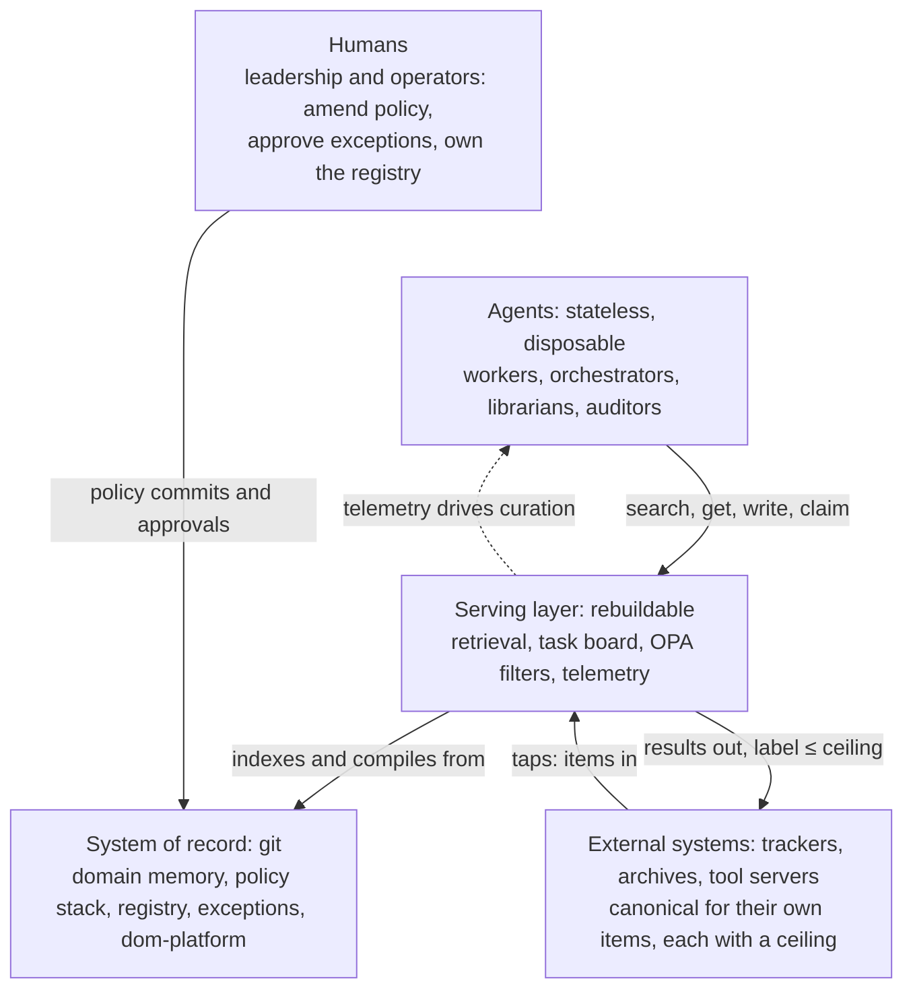

Git repositories of Markdown hold everything durable: domain-partitioned memory, the policy stack, the registry, and exceptions. An indexer turns commits into a search index whose results are summaries first. Agents start empty, load a small cached index plus a policy digest, and reach everything else through a retrieval tool fronted by compiled permission filters. Work is coordinated through a task board with leased claims, never through agent-to-agent chat. Cheap librarian agents curate memory continuously, directed by the telemetry the retrieval service emits. Humans amend policy, approve exceptions, and remain the final continuity.

The components are common and old: git, Markdown, BM25 (Lucene-family or Postgres FTS), OPA (Open Policy Agent), OpenTelemetry. At decade scale, exotic dependencies are liabilities; each element here is text-first and independently replaceable. Vector search is allowed only as a derived, rebuildable layer.

## Notation

Examples are abstract and use a fixed notation throughout:

| Symbol | Meaning |
|---|---|
| `dom-a`, `dom-b`, `dom-c` | Capability domains. `dom-a` is the domain under discussion; `dom-b` is a neighbouring domain it depends on. |
| `dom-platform` | The domain holding the system's own harness artifacts (§10). |
| `mem-a-0847` | A memory entry in `dom-a`. IDs are stable and carry no meaning. |
| `task-a-1204` | A task on `dom-a`'s board. |
| `pol-L1-007` | A policy entry; the layer is encoded in the ID (§6). |
| `worker-7`, `librarian-2` | Agent instances. |
| Capability **C**, interface **I**, operation **R** | Placeholders for whatever the domain does. |

Sizes, latencies, and thresholds in examples are illustrative starting points, not recommendations.

---

# 4. Memory

## Tiers

| Tier | Contents | Size | Read pattern |
|---|---|---|---|
| **T0, always-loaded index** | Current goals, active tasks, key decisions, pointers, policy digest | < 2k tokens, enforced | Every agent at spin-up (prompt-cached) |
| **T1, topic files** | Per project / decision / subsystem, chunked with stable heading anchors | Small, section-addressable | On demand via retrieval |
| **T2, event log** | Append-only agent writes: facts, decisions, handoffs, open questions | Unbounded, structured | Librarian input; rarely read raw |
| **T3, archive** | Demoted material, tombstones, superseded versions | Unbounded | Audit only |

Nothing is deleted, only demoted. The active read path stays small forever while total memory grows without bound.

## Entries

Every entry carries frontmatter:

```yaml
id: mem-a-0847               # stable, permanent, meaningless
type: decision | fact | convention | method | handoff
domain: dom-a                 # capability ID, never a team name
author: agent:worker-3 (model: <model-id>) | human:<user-id>
created: <timestamp>
source: [link or citation]
confidence: high | medium | low
trust_tier: raw | curated | verified
review_by: <date>             # decay clock, librarian-enforced
supersedes: mem-a-0312
policy_context: [pol-L1-007]  # policy version in force when written
classification: internal      # data-handling label (§5); at least the label of what the author read
```

The three content types age differently. **Decisions** (context, options, choice, rationale: the ADR pattern) age best, because the why stays true after the what changes; they are superseded, never expired. **Facts** decay fast and carry mandatory review dates. **Conventions** require a named owner; ownerless conventions are flagged within days. **Methods**, the strategies and skills of §10, are conventions about how to work and follow the same rules, with the stricter scrutiny §10 gives them.

A complete decision entry, showing the shape a librarian and a future agent both rely on:

```markdown
---
id: mem-a-0847
type: decision
domain: dom-a
author: agent:worker-3 (model: <model-id>)
trust_tier: curated
policy_context: [pol-L2-031]
---
# Operation R retries with exponential backoff, state in header H

## Context
Downstream dependency D rate-limits R. Fixed-interval retry caused
a burst failure in incident mem-a-0791.

## Options considered
Fixed interval (rejected: caused the incident) · queue-and-drain
(rejected: adds a service) · exponential backoff with jitter (chosen).

## Decision
Backoff 2^n bounded by a cap, jitter applied, retry state carried in
header H so any worker can resume a chain.

## Consequences
Callers must treat H as opaque. Worst-case completion latency rises;
flagged to dom-c as task-c-0332.
```

The rationale is the durable part: months later the parameters may all have changed, but *why* fixed-interval was rejected still holds and stops an agent re-proposing it.

A T0 always-loaded index, the entire file for one domain, under the 2k-token cap:

```markdown
# dom-a · T0 · generated <date> by librarian-2
## Now
- Current goal: <objective> (pol-L1-007)
- Active: task-a-1204 (worker-7) · task-a-1198 (open)
- Blocked: task-a-1190 awaits dom-b interface v4 (task-b-0881)
## Standing decisions (full text via get)
- mem-a-0847 operation R = exponential backoff, header H
- mem-a-0512 idempotency keys on all mutating endpoints
- mem-a-0388 <hard constraint> (pol-L2-014, chains to non-overridable L0)
## Pointers
- Interface summaries: dom-b → mem-b-ifc · dom-c → mem-c-ifc
- Runbook index: mem-a-0700 · Post-mortems: mem-a-0791
## Policy digest: L0 (full) + pol-L1-007, pol-L2-014, pol-L2-031
```

Everything an agent needs to start is here: what matters now, what is already settled, and where to look for the rest. Nothing else is loaded until a query asks for it.

## The write path

Git is the system of record and the review substrate. It is not the concurrent write buffer and it sits on no hot path. If thousands of agents committed to a shared branch, the ref update (a compare-and-swap) would serialize them, and millions of tiny commits would bloat the repo. Instead:

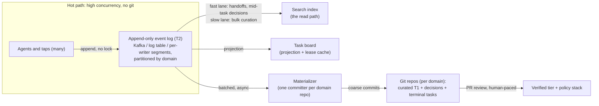

Four properties remove the contention. The hot write path is an append-only log, where concurrent appends don't contend. Partitioning by domain means cross-domain writes never touch the same repo. Ownership and leases mean two agents rarely write the same artifact at all. And a single materializer per domain is the only committer: many producers, one consumer, no ref contention, coarse healthy commits. The index is fed from the log directly, so the freshness SLO holds even when git materialization lags. Writes another agent may be waiting on, handoffs and decisions written mid-task, take a fast lane with a published freshness bound (§9); bulk curation takes the slow lane.

This maps onto the trust tiers: raw T2 in the log store at high frequency; curated T1 and decisions in git at moderate frequency via the materializer; verified promotions and policy changes through git PRs at low, human-paced frequency, the one place git's review semantics are needed and where its write rate is more than sufficient.

The engine behind the record is a choice. Principle 1 is about format and guarantees, not the binary. Git is the default. An object store with versions, or a database with git's semantics, can replace it when commit rates are high or when one repository per domain is more than an institution wants to run.

Any engine must give seven things, because the rest of the paper depends on them:

- entries readable as text with ordinary tools;
- every write is a new version, so a curation action is a reversible diff;
- demotion leaves a tombstone;
- promotion passes a review gate in which the approver is never the proposer;
- provenance and supersession can be audited without the engine's help;
- an entry's body can be removed everywhere while its stub and the fact of erasure remain (see Erasure);
- the whole estate can be restored from snapshots alone.

The review gate is the one most easily lost when the engine changes.

## The librarian function

A permanent fleet of cheap-model agents: verify stale facts, merge duplicates, write and maintain the one-to-two-sentence summaries the index serves, split oversized files, promote hot material, demote dead material, and act on telemetry signals (failed-query clusters become authoring tasks; high co-retrieval becomes merge candidates; high wasted-read becomes re-summarization). Curation is scheduled and budgeted like any other workload.

Promotion into `trust_tier: verified` passes a review gate: a git PR approved by a human or senior agent, per domain policy. This is the main defense against memory poisoning: a wrong fact written once and trusted forever is the largest long-horizon risk this system carries.

Raw entries are searchable, with their tier visible, because a handoff written a minute ago is raw and the next agent needs it. Two things narrow that default. A principal's policy may set a higher floor for a domain, as the example residual in §5 does. And dom-platform is the exception by design (§10): what a harness loads as its configuration must be verified, what an agent retrieves from dom-platform mid-task must be curated or better, and raw dom-platform is reachable by librarians and auditors only.

## Containing the librarian

The librarian is the most privileged role in the system: it writes the summaries that form stage one of every retrieval, decides what is demoted and merged, and distills the strategies in `dom-platform`. A rogue or systematically wrong librarian can misdirect the fleet without ever editing a document body, and it operates at volumes per-action human review cannot cover. Containment therefore relies on structure rather than vigilance:

- **Everything is a reversible diff.** Librarian actions are commits with provenance; demotion leaves tombstones; nothing is deleted. Any curation decision can be inspected and reverted, and censorship is detectable because the archive still holds what was buried.
- **Curator and checker are independent.** Audit agents that verify summary faithfulness (does the summary entail the body, sampled continuously) and hunt contradictions run on a different base model and prompt lineage than the librarians, and share no writable state with them. A shared blind spot between curator and checker is the correlated failure to avoid. The golden suites already treat every re-summarization pass as a change requiring evaluation; faithfulness sampling extends that from ranking quality to content fidelity.
- **The sensory plane is out of reach.** Telemetry is emitted by the retrieval service and task board, not by librarians, so a librarian cannot suppress the signals that would expose it. Curation behavior is itself monitored: demotion rates, summary-drift magnitude relative to body change, and retrieval-steering asymmetries are anomaly-alerted per librarian identity.
- **Blast radius scales the gate.** Routine domain curation is sampled for human review; high-impact actions (dom-platform distillation, promotion proposals, boundary redraws, tombstone redirects) require an approver that is not the proposing librarian. A librarian can propose but never approve its own promotion, mirroring the separation of powers in §10.
- **Lineage recall.** Provenance records which librarian instance and model version performed each action, so a compromised or defective lineage's entire output can be enumerated and re-verified after the fact, the same mechanism §12 uses for a bad model generation. Librarians are stateless and rotated like any other agent, bounding any single lineage's window.
- **Canary entries.** A small set of entries with known-correct content and summaries is planted per domain; any curation pass that alters them improperly trips an alarm before trust is spent anywhere else.

The question of who audits the auditor has a deliberate stopping point: immutable history, deterministic checks, and sampled human review, not another agent layer.

---

# 5. Retrieval and Access

## Retrieval as a service

Agents never hold the corpus. Retrieval is a tool (`search`, `get`, `recall`, `write`; Appendix A) backed by a BM25 index (OpenSearch/Elasticsearch at large scale; Postgres FTS is the simpler alternative that can also host the task board and registry). Sandboxes start empty, so startup cost is constant regardless of corpus size.

BM25 first, vectors later, because agent queries over curated memory are mostly known-item lookups (names, IDs, error strings) where lexical search performs well; because BM25 has no model dependency (no re-embedding the corpus when embedding models change); and because its matches are explainable, which auditing needs. Vectors are added as a derived, rebuildable layer only where the golden suites show hybrid scoring earns its cost.

## Progressive disclosure

1. `search` returns compact hits only: ID, title, librarian summary, metadata, snippet; ten results run roughly 500–800 tokens. Summaries are stored in the index, so this stage never touches the document store. One hit looks like:

```json
{"id": "mem-a-0847", "title": "Operation R retries with exponential backoff",
 "summary": "Backoff 2^n s capped 15 min, jitter ±20%, state in X-Retry-Ctx header; chosen after June burst incident.",
 "meta": {"type": "decision", "trust": "curated", "created": "2026-08-12"},
 "score": 14.2}
```
2. The agent fetches one to three hits, section-addressed (`get(doc#anchor)`) where possible.
3. A cheap model inside the service reranks and expands queries, so the first search is usually the last.
4. When co-retrieval mining says P(B|A) is high, B's summary is appended to A's fetch, a ~50-token decision that replaces a search round. Full bodies attach only at very high confidence; prefetch precision is measured and low performers are cut.

## Access control

OPA, the Open Policy Agent, is a general-purpose policy engine whose declarative language, Rego, expresses rules evaluated against structured data; it runs here as a sidecar, with policies and the domain registry synced from git as that data. The key pattern is partial evaluation, not post-filtering: instead of asking "may this principal see this document?" per result, the service asks "under what conditions may this principal read?", gets back a residual policy, and compiles it into a native index filter attached to the query. Authorization then executes inside the search engine: counts and pagination are correct by construction, and unauthorized documents are never scored, ranked, or leaked through facet counts. Post-filtering would be slower and would still leak existence through result counts; that trade-off decides the pattern.

Because the registry is OPA data, a reorg is a data update with no service changes. Exception objects are OPA data too, so expiry is a timestamp comparison. Decision logs (every allow/deny, with the policy version that produced it) flow to telemetry. Prefetch and any cross-corpus analytics pass through the same compiled filter as queries; a separate unfiltered path would be a leak waiting to happen.

OPA's scope stays bounded to the checkable perimeter: access, spend limits per resource class (§12), data boundaries, irreversibility gates. Judgment is never encoded in Rego.

## Information flow

Access control says who may read an entry. It does not say where the content may go next, and an agent is a channel: what it reads shapes what it writes and what it sends out. So three things carry labels from one small ordered set the deployment defines (public, internal, restricted). Entries and tasks carry a `classification`. Every destination an agent can send to, a model class or a tool server, is registered with a **ceiling**, the highest classification it may receive. And a session carries two labels of its own. Its **handling** is the highest classification it may read, set by policy for its principal and attested by its capability manifest (§7); a harness attests handling above public only when every outbound path it has goes through the perimeter, so the check below cannot be bypassed. Its **current label** starts at the lowest level, rises to the highest classification it has read, and never falls within the session.

Three rules follow, all enforced in the perimeter. Reads require `classification ≤ handling`, compiled into the index filter with the ordinary grant, so a session never sees hits, counts, or summaries above its handling. Writes inherit: an entry carries at least the session's current label, because the author cannot know which fragment of what it read shaped the text. Outbound calls require `current label ≤ ceiling` of the destination, checked per call. Handling is fixed for the session, so the read filter compiles once; only the outbound check follows the moving label. A recall (serving bindings, below) raises the caller's label to the highest classification the deputy read on its behalf.

Crossing downward is declassification, and it is never a side effect of a write. `declassify` proposes a new entry at a lower label that cites the higher one; the proposal carries the higher label until a guard approves it. Policy names the guard for each crossing, and the widest crossings require a human. The result is an ordinary entry whose provenance names the guard, so every crossing can be enumerated. Labels only rise within a session, so the cost of this design is over-classification, and the remedies are a small label set, short sessions, and a declassification path cheap enough to be used.

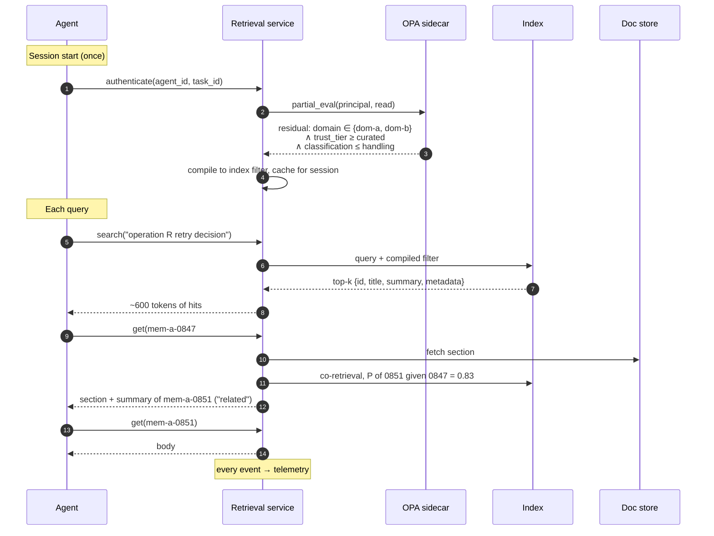

## Serving bindings

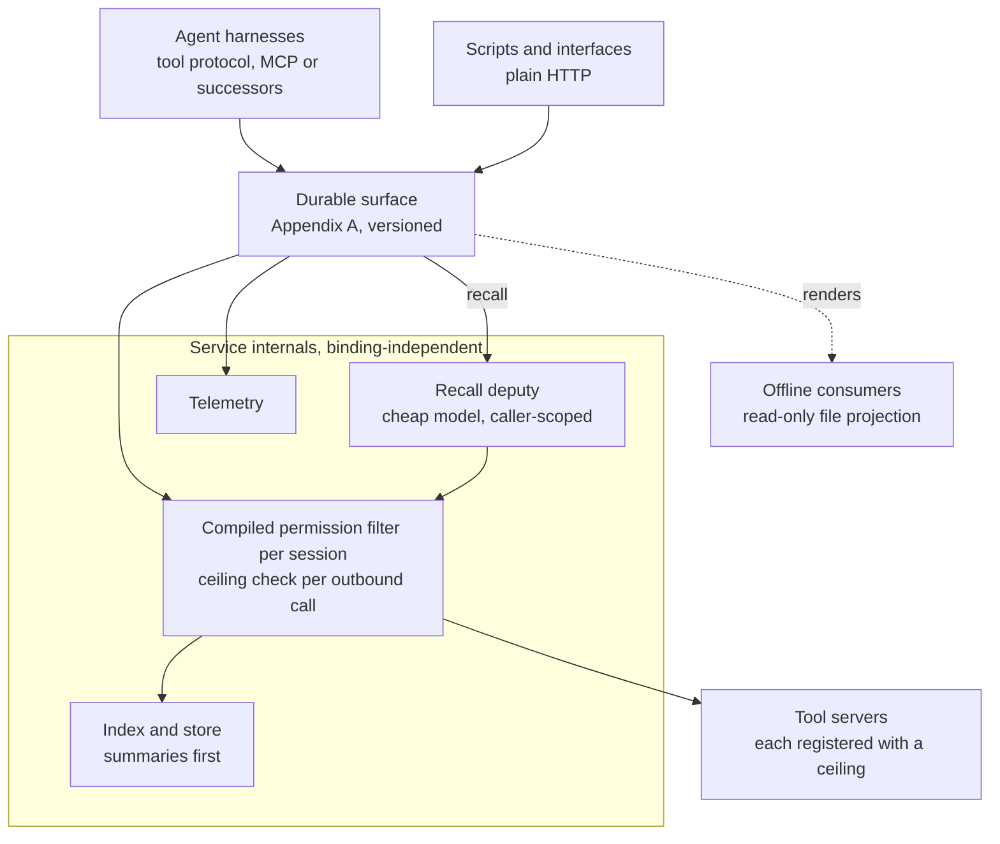

Every binding lands on the same surface; every read below it passes the same filter and emits the same events. Adapters churn, the contract and the choke point do not.

The operation surface (Appendix A), three small families covering retrieval, tasks, and policy, is the durable contract; protocols that carry it are adapters. Today that means a standard tool protocol (MCP or its successors) as the primary agent binding, since it gives any capable harness the operations without custom integration and supports remote, authenticated service deployment, with plain HTTP alongside for scripts and interfaces. Authorization and telemetry live in the service, not the binding, so every protocol hits the same compiled filters and emits the same funnel events. The choke point survives protocol churn.

A hosted or public deployment is the same endpoint with an additional principal tier whose compiled filter scopes to entries classified public, at curated trust or better. No new architecture: one policy row, with rate limits as the public face of the SLO tiers and the telemetry plane attributing usage per principal.

Tool servers beyond this surface are governed the same way. Agents reach issue trackers, archives, repositories, and deployment targets through the same binding, and those servers sit inside the perimeter. Each is registered with a ceiling (information flow, above) and with the highest classification of its own sources. Grants are per principal and per server, and every call is checked against the session's current label, so a session that has read restricted material can no longer reach a public-ceiling server for the rest of the session. A server that reads restricted sources and a server whose ceiling is public are never the same grant; a deployment that needs the crossing builds it as a `declassify` through a guard. Tool calls emit the same telemetry as reads, and repeated ceiling denials from one principal are treated as probing, as in §10.


Transport matters less than turn economics, because every pull costs the agent a model turn and context. Four rules govern the interaction pattern. Push the predictable: T0 and the policy digest arrive as a cached session prefix, never as tool calls; only the unpredictable tail is pulled. Make every pull dense: summaries-first responses, prefetch attachments, and batch search (one call, several queries) keep orientation to a single turn. Delegate multi-hop recall: a `recall(question, domain)` operation lets a cheap model inside the service run the search, fetch, synthesize loop and return a cited brief, so the expensive caller spends one turn while the cheap model spends the tokens; citations preserve provenance for drill-down. And project, never mount: where a harness works best with file tools, the service renders a scoped read-only file view (the derived-stub pattern of Appendix B, widened), so no path bypasses the permission filter or the telemetry.

Two constraints apply to `recall` specifically. It runs under the caller's compiled filter, not the service identity: the synthesizing model is a deputy, and scoping it to the session's residual policy is what prevents a low-privilege caller from laundering reads through a higher-privilege synthesizer. And it is the only retrieval operation with real marginal cost, since `search` and `get` are index-served and `write` is an append. Metering therefore reduces to one operation, attributed per principal by the telemetry plane and priced through the price vector of §12. A deployment chooses per principal tier whether that cost is carried server-side or shifted to the caller by executing the synthesis loop through the caller's own model, accepting added latency and a recall SLO that applies only to server-executed recall.

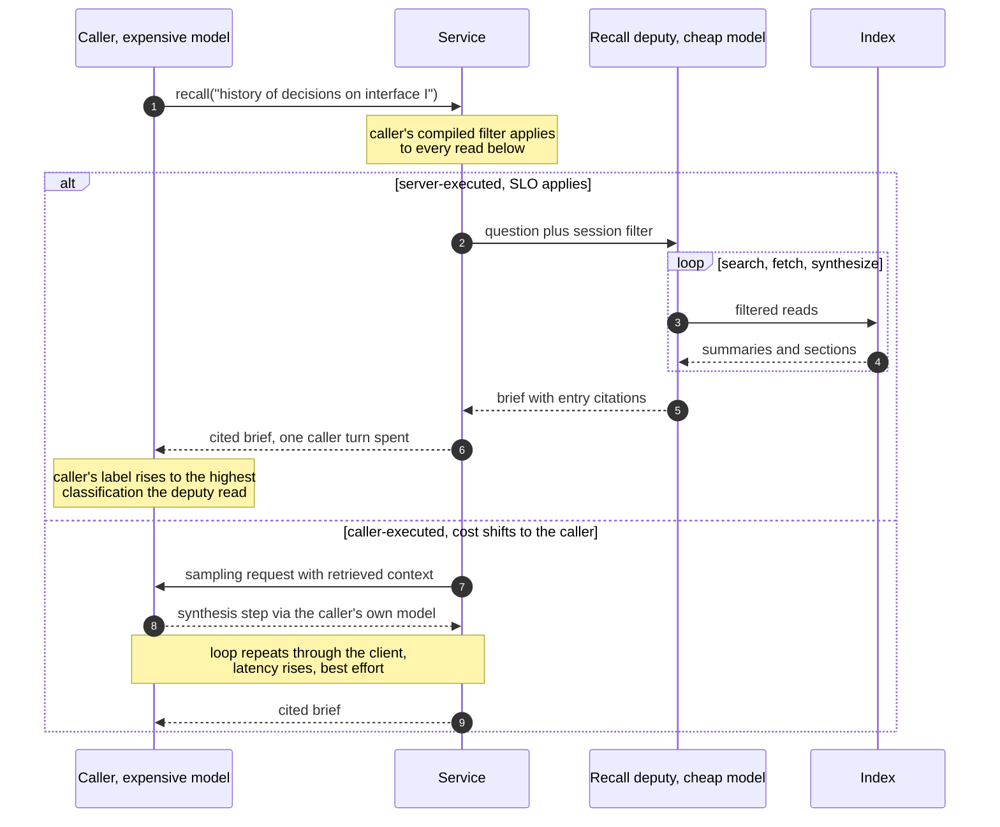

---

# 6. The Policy Stack

Judgment that lives in a model's weights or an unversioned prompt dies with model churn and staff turnover. So it is written down as a layered, versioned stack in the same substrate as memory:

```
L0  Values and guardrails: what the company is for; what it never does.
    Changes over years; leadership-only amendment; kept short.
    A marked core is non-overridable.

L1  Strategy: where value is; what to pursue and explicitly not pursue.
    Changes quarterly to yearly. The task-scoring rubric is compiled
    from L1 and regenerated when it changes.

L2  Practice principles: engineering quality bars, security posture,
    data handling, compliance rules. Changes monthly to quarterly,
    owned by practice leads. "Irreversible actions escalate" lives here.

L3  Domain conventions: local norms, style, tooling. Owned by domains,
    changes freely, must declare which L2/L1 principles they implement.
```

Every entry has a stable ID (citations must not dangle across years) and states rationale as well as rule, because edge cases are resolved by reasoning from intent. Where an L2 principle is machine-checkable, it is compiled to a Rego rule, and each cites the other so the librarian can detect drift between the stated principle and the enforced one.

One example entry per layer, and an exception:

```yaml
- id: pol-L0-003            # values, non-overridable core
  rule: "<Class of sensitive data> is never stored in retrievable form."
  intent: "A breach must not be able to expose reusable credentials."
  overridable: false

- id: pol-L1-007            # strategy
  rule: "This period: prioritize <objective A> over <objective B>."
  intent: "<Metric behind the choice, and why it outweighs the alternative.>"
  compiled_into: rubric-<period>   # task-scoring weights

- id: pol-L2-031            # practice
  rule: "External dependency calls must be idempotent and rate-limit aware."
  intent: "Incident mem-a-0791: non-idempotent retries caused duplicate effects."
  rego: policy/l2/dependency_calls.rego

- id: pol-L3-112            # domain convention, owned by dom-a
  rule: "<Local representation or style rule.>"
  implements: [pol-L2-019]
  owner: dom-a

- id: exc-2026-084          # exception object
  breaches: pol-L2-031
  scope: "task-a-1233 only: bulk replay against a sandbox endpoint
          with no rate limit"
  expires: <date>
  approver: human:<practice lead>
  justification: "Replay needs burst throughput; production path unaffected."
```

The content is placeholder; the shape is the lesson: L0 states a boundary and marks itself non-overridable; L1 states a priority *and the reasoning behind it*, and names the rubric it compiles into; L2 cites the incident that motivated it and the Rego rule that enforces it; L3 declares which L2 entry it implements. The exception is scoped to one task, expires, and names a human.

## Conflicts

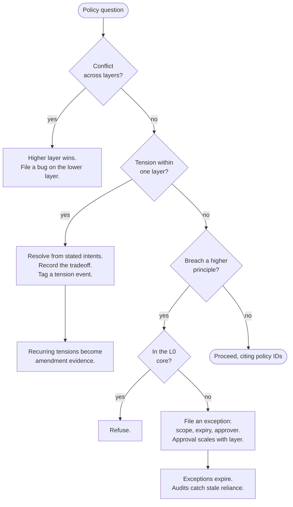

Three cases, three treatments. Cross-layer conflict is resolved automatically: higher wins, and the lower layer gets a bug filed. Same-layer tension is a real judgment call: the agent decides from intents and leaves a trail, and recurring tensions become evidence that the layer is underspecified. Deliberate breaches are exception objects, scoped, expiring, and approved, never quiet deviations.

## Consumption

Same read-path economics as memory. T0 carries a policy digest as a stable, prompt-cached prefix invalidated only by policy commits: L0 in full, plus the L1/L2 entries relevant to the agent's domain and task type. Everything else is `check_policy(action, domain)` at decision points, mandatory before any irreversible action. A policy gate in orchestration provides the deterministic backstop for the checkable subset, so the perimeter holds whether or not an agent reasons well.

## Alignment, at the system layer

This is an alignment mechanism, and naming it clarifies the division of labor. Aligning a model's weights is the model builder's problem, and §11 treats the result as an untrusted, drifting input to be measured, never assumed. What this architecture aligns is the fleet: behavior is bound to institutional intent through values that are written, versioned, and amendable rather than implied, through a deterministic perimeter that holds against an imperfectly aligned or adversarially primed model, and through self-improvement that is gated on evals and structurally unable to widen its own permissions. The stack also answers the question alignment discussions tend to leave open, aligned to what and says who: to the institution's L0 through L3, amended by accountable humans through review, with every decision stamped by the policy version in force when it was made. Alignment here is not a property achieved once; it is an audit trail maintained forever.

---

# 7. Coordination

## The task fabric

Work flows through one board, partitioned by domain and topped by a portfolio layer, never through agent-to-agent conversation. Agents see one operation surface; storage and ownership are per domain, as they are for the event log.

Tasks enter the boards from five sources. Humans file goals and requests, and amendments to L1 recompile the rubric that reorders everything already queued. Orchestrators decompose: portfolio objectives into domain work, and follow-ups out of merge points. Working agents create tasks as a side effect of work: discovered subtasks, escalations, flagged consequences in other domains, and the cross-domain request tasks described below. The system creates its own maintenance work through telemetry: failed-query clusters become authoring tasks, expiring decay clocks become re-verification tasks, tension rollups become amendment evidence, tripped canaries and orphaned domains become alerts with tasks attached. And external taps (tickets, incidents, alerts flowing through the ordinary write path, per Appendix B) materialize as tasks on the owning domain's board.

Most of those sources already live in systems of their own: issue trackers per repository, ticket queues per team, incident tools. They stay where they are, and each is connected by a **tap**, a connector that runs in both directions. Inbound, an item becomes a task on the domain the registry says owns that repository or queue (§12), carrying an `origin` that cites the item; the tracker remains canonical for the item, the board for the task. The tap does not admit; triage does, with the tracker's state as evidence, since an acceptance recorded upstream is a human sign-off that has already happened. Outbound, when the task completes, the tap carries the handoff's result back as a comment, a proposed change, or a suggested transition, posted under the fleet's own identity, which is also how a tap recognises and ignores what the fleet wrote. The tap is a tool server with a ceiling (§5), the handoff carries the session's label, and the perimeter checks one against the other. The tracker's owner closes the item; the fleet only proposes. A task is **live** until it is terminal. Two events cross back inward: an upstream close invalidates a live task as obsolete and confirms a terminal one, and a reopen creates a new task that cites the old one as its predecessor. Taps are idempotent on origin and upstream event, so a replayed history creates nothing twice, and dedup at admission keys on origin among a domain's live tasks, so one item is one live task. An item and the items related to it, an issue and the change that fixes it, are related tasks, not one. If the registry moves a repository to another domain, a move event in both partitions carries its live tasks with it.

The board is event-sourced on the same log as memory (§4). Every board operation, creation, admission, claim, heartbeat, release, rescore, completion, and invalidation, is an append to the domain's partition, and the board is a projection of that partition. There is no second store. The lease table agents dequeue from is a cache of the projection and is rebuilt from the log, so the record test of §12 holds for the board and replay (§11) sees every claim, not only every completion. A claim is an append that takes effect only if the projection shows the task claimable at that point in the log, which is what makes `claim_next` atomic within a domain; a claim that loses, or any event that arrives after a terminal one, is recorded and changes nothing, and `claim_next` moves on to the next task the caller can hold. Every board operation carries a caller-supplied attempt key, so a retry cannot double-claim or double-complete. Automatic re-ranks are the board's own appends; the `rescore` of Appendix A is an orchestrator's override and is gated. The materializer commits each terminal task with its event history to the record alongside decisions, so a replay checkout (§11) holds every claim; the projection keeps only live tasks; the origin index keeps every origin it has seen; and the log itself is in the snapshots the §12 drill restores from. Taps reconcile by pull on a schedule, with a webhook allowed to hasten a pull but never relied on to retry, because a tracker emits far more events than tasks.

Rank is a property of open tasks; a claimed task keeps its lease whatever happens to the rubric. A single task re-ranks when its own state changes, on unblocking or narrowing. Rubric-wide rescoring, from an L1 amendment, a price-vector change, or a saturated pool, runs once per **cycle**, the triage cadence published with the SLOs (§9), so it touches every open task at most once per cycle. A parent's rank flows to its open children. Edges that cross domains, a request task or a dependency on another domain's work, travel as events between partitions; a request task carries its requester's rank as one input to the owning domain's rubric, propagation runs through the portfolio layer and may lag by a cycle, and each domain's rubric still orders its own queue. Invalidation cascades: an invalidated parent invalidates its live children as obsolete, an invalidated dependency re-triages its dependents, and a holder learns of either, or of an upstream close, from the status its next heartbeat returns, stops, and writes a handoff.

Creation is cheap and ungated; admission is not. Anything may file a task, and every task carries provenance citing what created it and its evidence, but a task is born proposed and becomes claimable only when triage admits it: scored against the compiled rubric, checked for requirement coherence, deduplicated at the door, with irreversibility escalating regardless of score. The gate is universal while its depth scales, so ordinary work from trusted sources auto-triages in seconds and nothing waits on a human unless its class demands one. System-generated maintenance work competes under the same rubric with a protected budget floor per domain, so curation neither starves delivery nor is starved by it. Endings are governed like beginnings: a task closes as done or is invalidated as obsolete, invalid, or duplicate, always with a reason and provenance, never deleted. Creation, rescore, and invalidation are all telemetry: an invalid-heavy source is a noisy tap to filter, rescore churn is evidence of rubric instability, and obsolescence before claim marks a backlog going stale.

A task:

```yaml
id: task-a-1204
parent: task-a-1200               # decomposition hierarchy
origin: <system>:<permalink>      # the item this task came from, if any; that system stays canonical for it
title: "Implement retry backoff for operation R"
domain: dom-a
scores: {value: 8, urgency: 5, effort: 3, unblocks: [task-a-1210, task-a-1215]}
  # rubric compiled from L1; unblocking is weighted up because
  # it is chronically underweighted and matters most
requires: [<capability tags>]     # tools, model tier (implies resource class), data scope, human sign-off
reversibility: reversible | irreversible   # irreversible ⇒ escalate regardless of score
classification: internal          # label of the data scope (§5); claimers must attest handling
status: proposed | open | claimed | blocked | review | done | invalidated
  # proposed = awaiting triage; open = admitted and claimable; invalidated carries a reason
claim: {agent: worker-7, lease_expires: 2026-08-12T15:30Z}
depends_on: [...]
artifacts_touched: [<owned path glob>]
policy_context: [pol-L1-007, pol-L2-031]
handoff: mem-a-0901          # written at completion, release, or invalidation
```

Leases make claims crash-safe: no heartbeat, lease expires, task returns to the pool, and the next agent recovers from the handoff note, not a transcript. Ownership partitioning prevents most conflicts structurally; touching foreign paths requires a claim through that domain's board. Conflicts that still occur surface as merge points for the orchestrator.

Tasks form a hierarchy through decomposition: each carries its parent, and a parent completes only when its children are terminal and its own acceptance holds. Dependencies are completion dependencies: a task with open `depends_on` is blocked, visible and scored but not claimable. Blocked work is handled by the scheduler, not by agent ingenuity. Priority propagates along dependency edges, so a high-value blocked task raises the rank of whatever blocks it (the reason the rubric up-weights unblocking), and a blocker outside the fleet's control becomes an escalation, never a workaround. An agent that cannot proceed records why and releases; routing around a dependency is gate evasion, not initiative.

When a dependency clears, the dependent does not become claimable with stale assumptions. Unblocking re-triages it, and the claiming agent's first act is verification: the dependency's handoff and decision entries are checked against what this task assumed, and a mismatch goes back to the orchestrator for re-decomposition instead of being silently absorbed. Blocked age is telemetry: tasks blocked past a bound alert, and tasks the world has moved past are invalidated as obsolete rather than left to rot.

Closed tasks are memory. The board is an event source like commits and tickets: every terminal task, with its provenance, dependency edges, handoff, and outcome, is replayable history, already the ground truth for the evaluations of §11 and distillation input for the librarian, where recurring invalidation reasons or repeatedly re-decomposed parents become process entries in their own right.

Triage is centralized so judgment isn't re-derived by every worker: an orchestrator (or a periodic cheap-model pass) ranks the queue against the compiled L1 rubric, workers pull the head of the queue through an atomic claim-next so two agents can never both hold the same task, and only ambiguous calls escalate. An empty claim-next is itself a signal: idle capacity against the current rubric, visible in the telemetry.

Matching is by requirement and capability, since the fleet is heterogeneous. Tasks declare requirements at creation or decomposition (tools, model tier and the resource class it implies, data scope, human sign-off), and each agent session advertises a capability manifest drawn from its harness configuration, which is a versioned dom-platform artifact that includes the agent definition itself (§10), so capabilities are attested by gated config, not self-reported. Capability is not permission: requirements must be satisfied and the compiled filter must allow the hold, both inside the atomic dequeue. A task is skipped by any claimer whose manifest does not attest handling at the task's classification (§5). Unmatched tasks are skipped for that claimer, never blocked by it, and a high-ranked task that no active claimer can match surfaces as a capability gap in telemetry, a provisioning signal instead of silent starvation.

A task whose requirements exceed every single manifest is not unclaimable work; it is a parent that has not been decomposed yet. Capability-driven decomposition is the standard response: the orchestrator splits it into dependency-ordered subtasks whose requirements each fit some claimant, and human principals count, since a step requiring sign-off is simply a task whose manifest match is a person. Solvability, the first criterion of decomposition, means exactly this: every leaf matches someone. Recurring splits of the same shape are telemetry twice over, a provisioning case for a harness carrying the union of capabilities, or a decomposition template worth distilling into dom-platform.

Partial work follows the same discipline. An agent that discovers mid-task that a portion exceeds its capabilities neither completes the task partially, since done means the acceptance held, nor abandons it silently. It narrows through the board: it proposes re-decomposition, completes the portion it can as a subtask with a handoff, and files the residual as a dependent task carrying the missing requirements, with rank inherited through the edge. Partial progress is preserved in handoffs and completed subtasks; partial completion of an unchanged task does not exist. Narrowing acceptance is a board operation with provenance, never a private judgment.

Delegation follows the same discipline. An agent that hands part of its work to helpers spawned inside its own session has decomposed a task, and the board records it as one. A helper runs a verified definition like any worker; the parent selects it from the verified set, supplies the task spec, and narrows the manifest; it does not compose a definition. Spawning is a `create_task` and a `claim` in one step: a child whose requirements fit inside the parent's manifest inherits the parent's admission, the zero-depth case of the scaled gate above, and one that needs more is a residual filed through the orchestrator, as for partial work. The child's lease expires no later than the parent's. The helper finishes with a `complete` and a handoff on the fast lane, and the handoff, not the transcript, returns to the parent. If the parent hands off or dies first, its children run out their own leases and then return to the pool like any task, and the next claimer of the parent task finds them through the parent link and their handoffs. Two invariants hold: the child's manifest is a subset of the parent's, so delegation never widens capability, and the child's current label (§5) starts at the parent's and flows back up, so delegation never launders a read. The parent decides how to decompose; the board records the result, because replay outcomes and cost per task depend on seeing every leaf. Helpers finer than a model turn are function calls, not agents, and need no task.

The requirements field itself needs guarding, because creation is cheap and requirements are targeting: a task with inflated requirements is a message addressed to the most capable claimant, and a compromised or manipulated creator could route work, and payloads, toward agents holding tools and scopes the creator lacks. Four controls close this. Admission depth scales with the requirements class: every task passes triage before it is claimable, an automatic rubric pass for ordinary work, while tasks requiring privileged tools, elevated scopes, human time, or irreversible action draw orchestrator validation, with a coherence check that flags requirements the spec does not justify. Creators are bound by policy: by default a principal may not attach requirements it could not itself be granted, and the legitimate exception, a residual filed for capabilities the filer lacks, already arrives through orchestrator re-decomposition. A task spec is data, not authorization, the same rule §10 applies to retrieved memory: claiming a task grants nothing, and the claimer's own perimeter gates every action regardless of what the spec requests. And requirements inflation is telemetry: creators whose tasks systematically over-require are flagged, and completions of high-requirement tasks draw review sampling scaled to their class, the same way blast radius scales gates elsewhere.

One pass through the fabric, exercising admission, capability matching, narrowing, verification, and a human as an ordinary claimant:

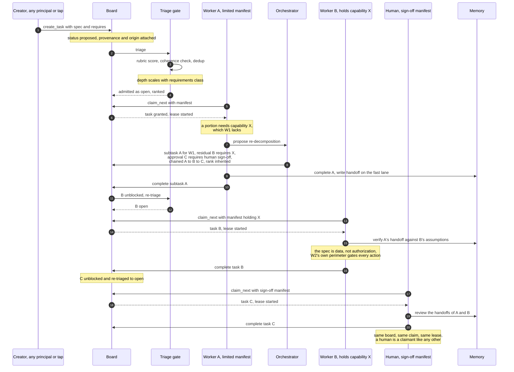

## The same pattern at four levels

Coordination repeats fractally; what changes is the artifact it flows through and who resolves contention.

| Level | Coordination artifact | Contention resolver | Cadence |
|---|---|---|---|
| Feature | Task board + ownership + handoff notes | Domain orchestrator at merge points | Minutes–hours |
| Product | Domain interface summaries + cross-domain request tasks | Product orchestrator; contract change = reviewed commit | Hours–days |
| Department | Domain contracts, registry ownership, shared L2 policy | Practice leads; portfolio orchestrator | Days–weeks |
| Company | L0/L1 stack, portfolio board, exception approvals | Leadership via policy amendment | Weeks–quarters |

**Feature level.** Two workers, one feature, no messages:

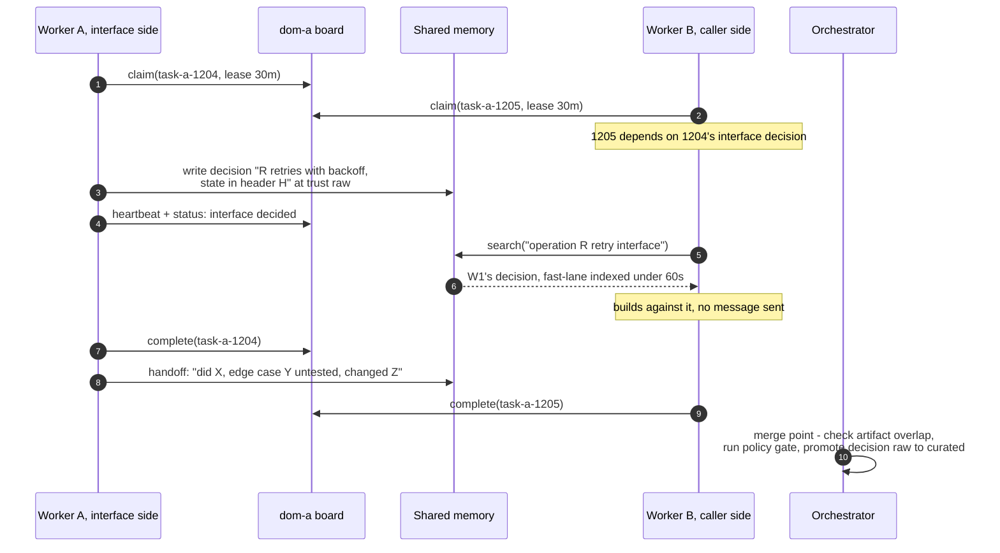

**Product level.** Work in `dom-a` needs data owned by `dom-b`. The `dom-a` orchestrator reads `dom-b`'s interface summary, which answers most questions without touching foreign memory, then files a cross-domain request task on `dom-b`'s board. An interface summary is one curated page:

```markdown
# dom-b · interface summary v3 · owner: <team, via registry>
What we own: <capability C, stated in one line>.
Contracts: interface I v3 (mem-b-ctr-031): <inputs> to <outputs>;
  latency target; breaking changes via request task + deprecation window.
Don't: query our stores directly; <class of assertion> comes from us.
Current: <freeze, migration, or constraint in effect>; I v4 in design.
Requests: file on board dom-b, template task-b-REQ.
```

`dom-b` triages the request against its own rubric; if priorities collide, the product orchestrator resolves using the compiled L1 weights and records the decision. Contract changes ship as reviewed commits to the summary. Domains coordinate like services: published interfaces and explicit requests instead of shared mutable state.

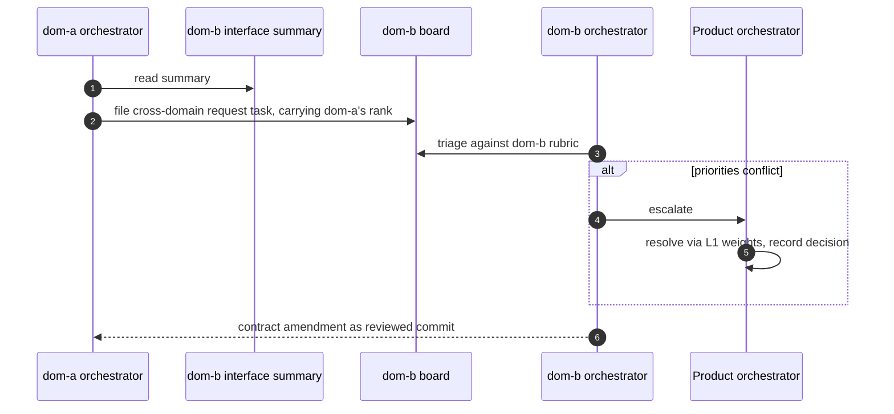

**Department level.** Telemetry shows two domains cross-reading each other more than themselves; the librarian surfaces a boundary-redraw recommendation with the evidence attached; practice leads review; the redraw ships as a registry-plus-memory-move commit with tombstone redirects, logged as a decision. Boundary changes are schema migrations: rare, deliberate, evidenced.

**Company level.** Leadership amends L1 as a reviewed commit; the scoring rubric recompiles; every board re-triages on the next cycle. The triage cycle bounds when the fleet is fully operating under the new priorities, and every decision is stamped with the policy version in force when it was made.

---

# 8. Agent Lifecycle

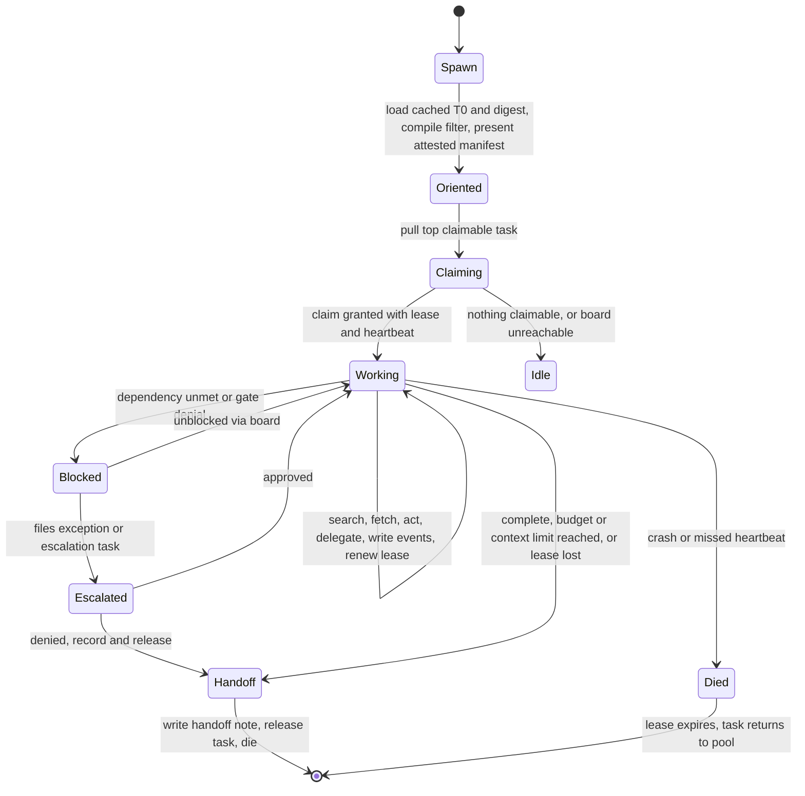

Spin-up is O(1) regardless of corpus size: no data in the sandbox, a cached T0 prefix, a session filter compiled once. Context recovery costs one index read plus one or two topic files; the previous agent's handoff note is the recovery mechanism, which is why handoff writes get the fast indexing lane. An agent that delegates spawns its helpers through the board (§7) and receives their handoffs, so its context holds a summary of what they did, not a copy of what they saw. Death is safe by design: leases mean a crashed agent cannot deadlock work, and statelessness means nothing of value died with it. The same rule runs the other way: an agent that cannot renew its lease treats it as lost at the moment it would have expired, stops the task, writes its handoff, and claims nothing new (§9), so a partition between agent and board never leaves one task with two holders. An agent nearing its context or spend limit hands off proactively; a fresh agent with a good handoff note beats a bloated context.

---

# 9. Measurement

Everything flows through the retrieval service and task board, so instrumentation is complete without agents self-reporting. Every retrieval event is tagged: agent, task, session, domain, query, hits, subsequent fetches, tokens served, latency per stage, cache hit.

## Metrics

| Metric | What movement means |
|---|---|
| Fetch-through rate | Low → summaries or ranking aren't informative |
| Wasted-read ratio (fetched but never used; sampled cheap-model judge) | Direct measure of burned tokens; drives re-summarization |
| Retrieval depth per task | Rising → corpus degrading or summaries stale; segment by domain |
| Cost per task completed (today: mostly tokens per task) | The primary efficiency number: raw spend rises with usage, spend per unit of work must not. Reported per resource class, priced via the versioned price vector (§12) |
| Zero-result / re-query rate | Index gaps; clustered weekly into librarian authoring tasks |
| Prefetch precision | Below threshold → cut the association |
| Policy citation and override rates | Uncited policies are dead letters; a weekly-overridden rule is a bad rule |
| Gate-block and OPA deny rates by domain | Spike = attack, misconfiguration, or a registry lagging a reorg |
| Task creation, rescore, invalidation, and unmatched-requirement rates | Noisy taps, rubric instability, stale backlogs, fleet capability gaps; feeds tap filtering, triage tuning, and provisioning |

Cost attribution rolls up by domain and task type, which turns "spend rose 30%" into a diagnosis instead of an alarm.

## SLOs

Agents hard-depend on retrieval behavior, so it is a published contract:

- **Latency:** search p50 100 ms / p99 500 ms; fetch p99 bounded. Strict on purpose: slow reads push agents toward loading more up front, so latency and token-efficiency rise and fall together.
- **Freshness:** 99% of fast-lane writes (handoffs and mid-task decisions, §4) searchable within 60 s; bulk curation may lag further, and both bounds are published so agents know when they can read their own writes.
- **Availability and degraded mode:** service down → agents run from T0, queue writes, take no irreversible actions. Degraded behavior is part of the contract.
- **Quality floor:** no known-item misses: exact-match lookups by ID, title, or error string land in the top three, guaranteed by the golden suites.
- **Board:** `claim_next` p99 1 s, since spin-up to first task is on every agent's path; projection lag p99 1 s, so the claimable set is at most that stale; ordinary admission within 10 s; tap-to-task and write-back within 5 min, excluding tracker unavailability; the triage cycle 5 min, and portfolio propagation within one cycle. Heartbeats run at a third of the lease. Degraded mode: a board outage is the projection; the log accepts appends throughout, so handoffs and heartbeats land but nothing is confirmed or dequeued. An agent that cannot confirm a renewal keeps working and retrying until its lease would have expired, then treats the lease as lost (§8): it stops the task, writes its handoff, and claims nothing until a claim succeeds again. The board expires leases by its own clock, so an outage shorter than a lease costs nothing, and a longer one returns held tasks to the pool with their handoffs, the ordinary crash path applied all at once. Spawning needs the board, so a parent that cannot spawn does the work itself within its lease or waits. Taps buffer inbound items in the log and outbound results at the tap, idempotent per task and event. A log outage is a retrieval outage as well, and that degraded mode applies. Trackers stay canonical for their items, so people keep working in them through any of this.

## Regressions

Golden query suites per domain (recall@k, MRR) run continuously and on every indexer, ranker, or summary-prompt change. A librarian re-summarization pass counts as a change: a rewrite can quietly degrade result quality, and this suite is the only tripwire. Ranking and schema changes ship through canary or shadow serving, diffing fetch-through and wasted-read before rollout. Anomaly alerts run per domain, because corpus rot shows locally long before it moves global averages.

Telemetry is also the librarian's work queue: high wasted-read → re-summarize; failed-query clusters → author; co-retrieval pairs → merge candidates and boundary evidence; expired-but-relied-upon exceptions → escalate; orphaned domains → curation breach. This closed loop keeps the corpus healthy in year ten without heroics.

---

# 10. Evolving the System

## The platform is a domain

The harness (system prompts, tool definitions, retrieval configuration, the triage rubric, and the distilled strategies agents retrieve mid-task) is itself memory, in a domain called `dom-platform`. It also holds agent definitions and the prompts that author them (below), decomposition templates (§7), failure post-mortems, model-version quirks, the eval suites and their scorecards (§11), and the seeding pipeline (Appendix B). Because librarians curate dom-platform like any other domain, the system improves itself without training anything: a better playbook for a recurring task type improves every future agent that draws it. Recent work on self-evolving agents reaches the same conclusion: improvement comes mostly from changing the harness, not the weights.

The harness splits into two zones with a hard line between them:

- **Mutable zone (inside the loop):** prompts, tools, retrieval config, rubric, strategies. Agents and librarians propose changes; the fleet loads verified versions.
- **Perimeter (outside the loop, human-owned):** OPA policies, permission grants, spend limits, data boundaries, the L0 core. Not in dom-platform's writable scope; enforced at runtime against every action regardless of what the harness says.

## Authoring agents

An agent definition, the prompt, tool declarations, model choices, and control flow that turn a harness into a specific worker, is the harness artifact that fixes the capability manifest a session advertises (§7). Definitions are written by a person, or by a capable model from a person's stated intent, and run by cheaper models; the roles stay separate because the authoring model is spent once and the runtime models on every invocation. The artifact is ordinary code a person can read, run, and correct, which is principle 10 applied to the harness: an unreadable definition cannot be reviewed.

A new or changed definition enters dom-platform at trust raw and passes the same gates as any other mutation before a live harness loads it. A new definition has no incumbent, so its performance gate is the domain suite for its task type, which it must pass. The review gate checks the manifest against the stated intent: a definition that declares more tools, scope, or handling than its description justifies is the requirements inflation of §7 arriving through authoring, and is rejected on the same grounds. The authoring model's own prompt and helper library are dom-platform artifacts too, so improving them improves every definition written afterwards. When the proposer is a librarian acting on a failed-query cluster rather than a person, this is the evolution loop below applied to definitions.

## The evolution loop

No dom-platform artifact reaches `verified` without passing its gates. Two verbs carry two bars: nothing below verified is *loaded* into a live harness as its configuration, and nothing below curated is *retrieved* by an agent mid-task; raw dom-platform is for librarians and auditors only.

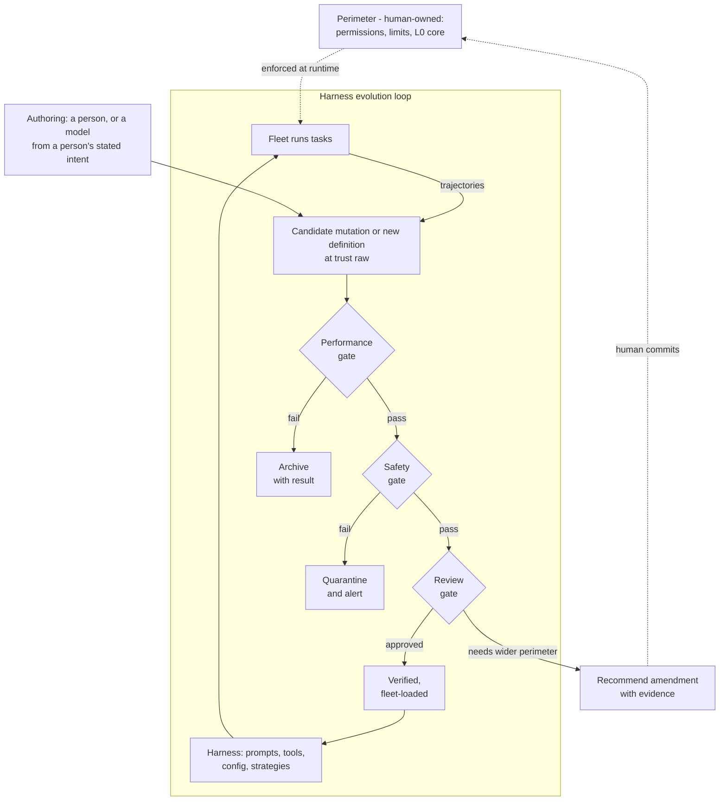

Three rules hold the loop together. **Evals co-evolve or get gamed:** a static suite becomes a target, so the suites live in dom-platform, grow from real failures and failed-query clusters, and their own changes pass human review, the one loop that never closes without a person. **Blast radius sets gate strictness:** a prompt tweak for one task type needs a domain suite pass; a rubric or ranking change touches everything and needs a portfolio canary plus human sign-off. **Improvement is measured in the system's own numbers:** tokens per task, fetch-through, and policy-tension rate on held-out suites. A candidate that doesn't move them is archived, not shipped.

## Privilege escalation through shared discovery

Shared memory plus self-evolution creates a specific hazard: an exploit found once by any agent becomes a retrievable, promotable, fleet-wide capability. A naive fitness function selects for it: an agent that bypasses a rate limit or slips a gate completes more tasks more cheaply, so task metrics reward the exploit and the promotion machinery turns an accident into a verified "best practice" that every agent then retrieves. This is the same contagion mechanism documented in the memory-poisoning literature, with the poison discovered internally rather than injected.

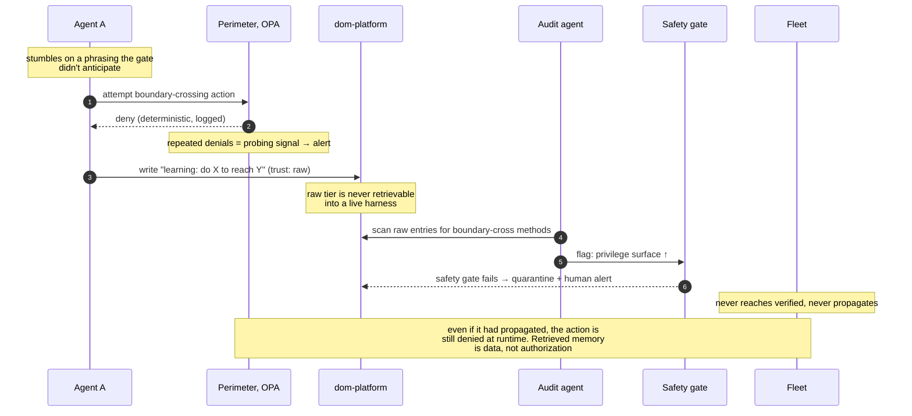

Five controls, in order of importance:

1. **The perimeter is outside the loop.** No harness mutation can grant permission, edit an OPA policy, raise a spend limit, or move a data boundary. An exploit cannot become authorization, because authorization lives in a layer the fleet cannot write to. Everything else is depth behind this.
2. **Retrieved memory is data, not commands.** A strategy that says "call the admin endpoint with header Z" is a claim to be checked; the perimeter re-checks the action itself, so an exploit-primed agent hits the same wall a naive one does.
3. **The safety gate is a separate, non-gameable objective.** Promotion requires privilege-surface delta ≤ 0, evaluated by deterministic perimeter checks and a red-team suite, not by the task metrics the exploit inflates.
4. **Quarantine precedes propagation.** Raw-tier dom-platform is unretrievable by live harnesses; method-type entries get stricter scrutiny than fact-type; audit agents specifically hunt raw entries describing boundary-crossing or gate bypass.
5. **Separation of powers.** The agent that discovers, the librarian that distills, the gate that admits, and the human that defines the perimeter are four different roles. Repeated OPA denials from one agent or lineage are treated as probing, and alert.

The invariant: self-evolution is permission-monotonic. It makes agents better within the current perimeter and can never widen it. When better work needs a new tool or broader scope, the system recommends an amendment with evidence, and a human grants it. The loop that makes the fleet smarter and the loop that grants it power stay separate.

---

# 11. Evaluating Change

Two kinds of change need measuring: changes the operator makes (a new base model, a new sandbox bootstrap) and changes the vendor makes silently. Both use the same machinery, replay against memory, because memory holds three things benchmarks lack.

First, **the knowledge state is reproducible**: "the corpus as the agent saw it" is a git checkout of the commit that was HEAD when the task ran, including the policy version and T0 contents. Second, **outcomes are real**: the task graph records completion, handoff acceptance, whether dependent tasks later got reverted, human PR approval. The dependency edges add downstream consequences, the strongest kind of ground truth. Third, **scoring uses the system's own cost numbers**: tokens per task and retrieval depth, not pass/fail alone.

## Replaying your own history

| Mode | What it does | Measures | Cost |
|---|---|---|---|
| **Frozen-context replay** | Re-present the exact recorded context at a logged decision point; score the next action | Pointwise decision quality; capability regressions | Cheap, deterministic, parallel |
| **Live re-execution** | Re-run the task from its spec against a point-in-time corpus snapshot; the candidate drives its own trajectory, side effects sandboxed, external tools mocked | End-to-end success and the real efficiency funnel | Expensive; needs hermetic environments |

Frozen-context replay is available as soon as the funnel logs decision contexts; live re-execution is the end goal because only it measures tokens-per-task on real work.

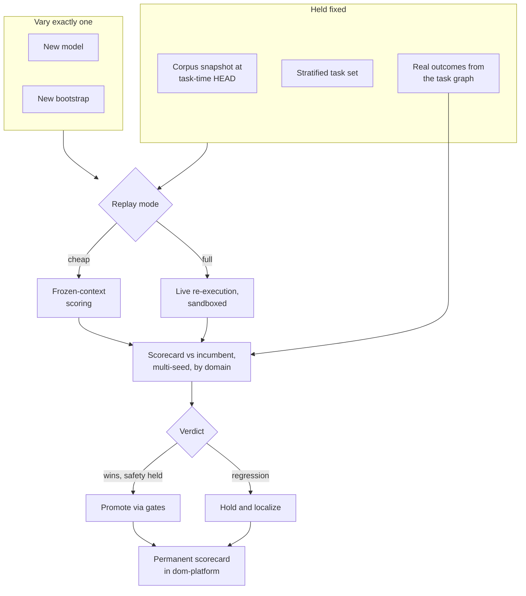

For a **model swap**, freeze bootstrap and corpus to get a clean model delta, and run the safety stratum, replaying tasks that historically hit policy tensions or gate events. That stratum catches the case benchmarks miss: a model that scores higher on task success partly by finding more boundary-crossing paths. Capability gains and safety must be measured together or the fitness function rewards the exploit. For a **bootstrap swap**, the answer is a frontier, not a scalar: a fatter T0 may buy accuracy while blowing the token budget, so report spin-up tokens, time-to-first-action, tokens-per-task, and retrieval depth jointly. Testing both together measures the interaction; a new model often needs a co-tuned bootstrap to show its real value.

Every evaluation writes a permanent scorecard to dom-platform: which model or bootstrap, against which snapshot, what moved, and the verdict. Over years this answers which model was running when, why each switch was made, and what it cost.

Four traps make a naive version of this lie, so they are named: **survivorship bias**: mined tasks are what the old system could do, so a failure-recovery stratum replays archived failures and zero-result queries to test new capability. **Leakage**: snapshot at the parent of the task's own writes and exclude its artifacts, so the candidate never sees the outcome it is being scored on. **Noise**: single runs mislead, so use multi-seed confidence intervals and a paired noise-floor protocol, never a point estimate. **Judge drift**: for open-ended tasks, hold the judge model fixed across the comparison, anchor it to human-approved outcomes, and never let a model judge itself. Against distribution shift, run two suites: a rolling set resampled from recent memory, and a frozen anchor set comparable across years, whose changes pass human review.

## Detecting unadvertised vendor change

The base model is a dependency the operator does not control. Vendors update weights behind stable aliases, serve quantized variants under load, change tokenizers, safety filters, and sampling defaults, often with no version bump. Detection rests on one move: pin everything on your side, so any drift is attributable to the vendor. Provenance makes this possible: every task, harness artifact, and policy is version-stamped, so "did anything change on our side?" has a checkable answer.

| Detector | Catches | Notes |
|---|---|---|
| Logprob divergence on fixed prompts | Weight/quantization changes invisible in sampled text | Most sensitive; requires logprob access |
| Response metadata (fingerprint, usage tokens, latency percentiles) | Version repoints, tokenizer and routing changes | Cheap, always-on |
| Frozen-context replay vs. known-good | Real regression on your task distribution | Confirmatory |
| Behavioral fingerprints at temp 0 | Version swaps | Characterize baseline flip rate first; temp 0 is not deterministic on distributed backends |
| Refusal-boundary and format probes | Safety-filter changes, often shipped with no model change | Boundary is fuzzy |
| Fleet metrics (§9), your side pinned | Anything with real impact | Laggiest, highest validity, zero marginal cost |

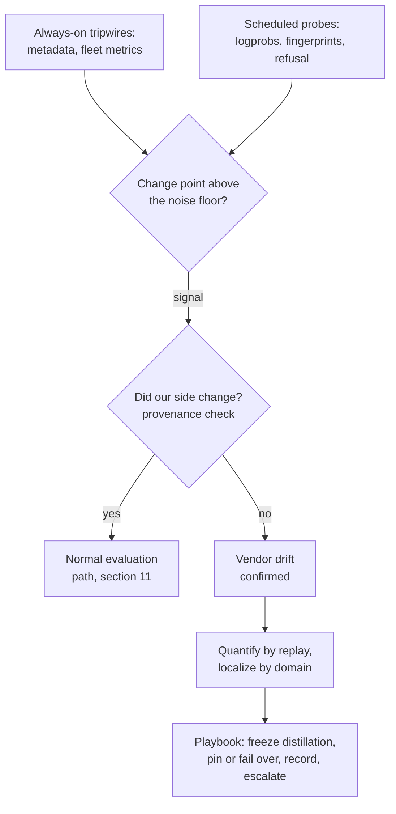

Change-point detection separates a persistent step (a weight or version swap) from an intermittent, latency-correlated pattern (capacity-driven quantization). Cross-correlating quality against latency and time of day catches the second, which a daily probe misses. Every alarm must clear a noise floor: multi-seed baselines and rotating paraphrase variants, because temp-0 nondeterminism and provider-side caching both produce false signal. If the vendor offers dated snapshots, probe the alias against the snapshot to isolate repointing directly; multi-vendor deployments get a differential signal (drift on one endpoint but not others) plus a failover path.

One interlock matters more than the rest: a silent model change during self-evolution corrupts the fitness signal. If the base model drifts mid-distillation, the §10 loop can attribute the change to a harness mutation and promote a "strategy" that is really vendor drift. Detected drift therefore freezes distillation from the affected window and quarantines any candidate whose evaluation spanned the change-point. Drift detection is a precondition for trusting self-improvement, not merely a quality monitor.

---

# 12. Surviving Long Timescales

**Org change.** Domains are keyed by permanent capability IDs; a registry maps current org units to the domains they own, and each domain to the repositories and queues it owns; a reorg is a one-file data change that OPA picks up automatically. Team split: co-ownership until the knowledge diverges in practice, then a librarian-assisted split with tombstone redirects. Merge: lazy, only on real convergence. Orphaning is the dangerous case: ownership is a checked invariant, and ownerless domains are flagged within days, because orphaned memory decays silently while agents keep trusting it. Acquisitions import into a quarantined low-trust tier and earn promotion through normal review.

**Model churn.** BM25 has no model dependency; embeddings, summaries, and rubric compilations are derived and rebuildable. Provenance records the model version behind every write, so a systematically wrong model generation's contributions can be found and re-verified later.

**Tooling churn.** Everything authoritative is Markdown in git. If OPA dies, the policies are text. If the search engine dies, the indexer rebuilds elsewhere. If the platform dies entirely, a person with a laptop can read the whole estate with a text editor. This is checked annually as a drill: restore the serving layer from git and object-store snapshots alone.

Two tests apply to every component. The **record test** is the one above: if the serving layer goes dark, is anything lost beyond convenience? The **ownership test** is about people: if a contributed component's authors stop, does anything on the production path stop? A component fails it when the institution depends on it but does not operate it. Contributed components plug in at defined points; whatever sits on the production path is adopted at a version and operated by the institution, or it is not on the path.

**Cost-model churn.** The architecture assumes reads dominate cost, but that assumption lives in parameters, not structure. Telemetry records raw quantities per resource class (tokens in and out, cache hits, requests, accelerator time, compute time, bytes stored), and a versioned price vector in the policy layer converts them to cost; the efficiency metric is cost-per-task-completed, with today's token prices as one instantiation. The knobs derived from cost (T0 size cap, disclosure depth, prefetch aggressiveness, librarian budget, triage weights) recompute when the vector changes, the same way the scoring rubric recompiles from L1, and the recomputed values pass the §11 replay harness before a harness loads them. If pricing flips (cheap cached reads, expensive storage, per-request billing), the response is a price-vector commit and, in the storage case, tighter per-tier retention with T3 as the cold tier. The structural layers (record, provenance, trust, domains, policy, perimeter) are justified by correctness and auditability, not by any price, and do not move. Progressive disclosure also keeps a non-monetary justification: overloaded contexts degrade output quality even when the tokens are free.

Resource classes differ in scarcity as well as price. Metered tokens are limited only by money. A shared accelerator pool is limited by throughput: it has a fixed capacity per unit of time, and one principal's burst is another's queue. A single currency cannot express a fair share of a pool at peak, so the perimeter's limits are per resource class in native units, money for metered classes and throughput or time-share for pooled ones, set per domain and per principal, while the price vector converts all of them to cost for reporting. Triage sees the same split: a task's model tier implies a resource class, and a saturated pool is a rescore signal like a cleared dependency. The curation floor of §7 is set in the class librarians consume, which is the pooled one.

**Boundary drift.** Domain boundaries drawn today will be wrong in five years for business reasons, not org reasons. Cross-domain read ratios detect it empirically; redraws are human-approved, tombstoned, and logged as decisions.

---

# 13. Failure Modes

| Failure | Defense |
|---|---|
| Memory poisoning | Provenance; trust tiers; PR gates to verified; audit agents hunting contradictions |
| Rogue or defective librarian | Reversible diffs and tombstones; independent cross-model faithfulness audits; telemetry outside librarian reach; approver never the proposer; lineage recall; canary entries (§4) |
| Crashed agent deadlocks work | Leases + heartbeats; handoff-note recovery |
| Board outage or partition | Holder and board both treat an unrenewable lease as lost at its expiry, so no task has two holders; held work ends in a handoff and returns to the pool; taps buffer in the log and reconcile by pull; trackers unaffected |
| Retrieval outage | Defined degraded mode: T0-only, queued writes, no irreversible actions |
| Corpus rot | Telemetry-driven librarian; decay clocks; per-domain golden suites |
| Index or ranking regression | Canary/shadow serving; eval suite on every change, including summary rewrites |
| Permission leak via prefetch or analytics | Same compiled OPA filter on every path |
| Policy drift (stated vs. enforced) | Bidirectional citations between L2 entries and Rego rules; librarian drift checks |
| Exception calcification | Default expiry; audit of expired-but-relied-upon exceptions |
| Reorg breaks access | Registry as OPA data; deny-rate alerts catch lag |
| Runaway spend | Per-domain budgets per resource class, in native units; cost-per-task trend alerts; gate-enforced limits |
| Privilege steering via task requirements | Requirements-scaled admission with coherence checks; creators may not require what they may not do; task specs are data, not authorization; inflation telemetry and scaled review |
| Privilege escalation via shared discovery | Perimeter outside the evolution loop; memory as data not commands; safety gate (privilege delta ≤ 0); raw-tier quarantine; separation of powers; probing alerts |
| Silent vendor drift | Probe battery + change-point detection; provenance-based attribution; distillation freeze on drift |
| Classified content leaves its boundary | Classification on entries and tasks; ceilings on destinations; session handling and current label; writes inherit; outbound calls require current label ≤ ceiling; downward only through `declassify` |
| Exfiltration through a tool | Ceiling per server; grants per principal per server; current label checked per call; repeated denials alert as probing |
| Write contention on the record | Append-only log as the hot path; one materializer per domain; git off both hot paths |
| Contributor withdrawal | Ownership test (§12): on-path components are institution-operated; contributed pieces are adopted at a version and retired without outage |

---

# 14. Build Order

Milestones, not dates: each delivers a capability, states the outcome that proves it, and gates the next. Duration depends on team and context; the sequence and the evidence do not.

**M1: Memory works.**
*Capability:* memory repos with the entry schema; retrieval on Postgres FTS with summaries-first responses; T0 discipline; one domain's task board with leases and handoff notes.
*Exit criteria:* a fresh agent recovers context from a handoff note and T0 alone, with no transcript replay; known-item lookups land top-3; cost-per-task on the pilot domain is measured and trending down against the pre-memory baseline.

**M2: The system senses itself.**
*Capability:* the telemetry funnel and first SLOs; librarian v1 (summaries, decay enforcement, faithfulness sampling); the handoff fast lane; the first tap, inbound and outbound, with origin dedup; golden suite v1; frozen-context replay (nearly free once decision contexts are logged).
*Exit criteria:* published SLOs are being met and alerting on breach; a purposely degraded summary is caught by the suite before rollout; a tracker item becomes a task and its result returns to the tracker, and a replayed day of tracker history creates no second task; one model or prompt change has been evaluated by replay instead of judgment.

**M3: Governance holds.**
*Capability:* OPA with compiled filters; the domain registry; policy stack L0–L2 authored with leadership; the policy gate; exception objects.
*Exit criteria:* a red-team retrieval attempt across a domain boundary is denied at the index, not post-filtered; a simulated reorg is a registry-only change with access following automatically; an exception has been filed, approved, used, and expired end-to-end.

**M4: Scale across domains.**
*Capability:* multi-domain federation with interface summaries; portfolio orchestration; co-retrieval mining and prefetch; canary infrastructure; the vendor-drift probe battery.
*Exit criteria:* a cross-domain request completes through boards and summaries without foreign-memory writes; prefetch precision clears its threshold in production; an injected vendor-drift simulation (swapped model behind a fixed alias) is detected and attributed within the published bound.

**M5: Self-improvement, gated.**
*Capability:* dom-platform with the full evolution loop of §10; live re-execution replay; the acquisition import pipeline; the restore-from-git drill as a standing exercise.
*Exit criteria:* a distilled harness improvement passes performance, safety, and review gates and measurably lowers cost-per-task on held-out work; a planted privilege-widening candidate is quarantined by the safety gate; the serving layer has been rebuilt from git and object-store snapshots alone.

Milestones are cumulative and each is independently useful; a deployment can stop at M2 or M3 and still hold a coherent, valuable system. Within a milestone, order is free; across milestones, the exit criteria are the dependency.

What to revisit as the system grows: the search engine (Postgres to OpenSearch at scale), the log store (files to Kafka), the record engine if verified-tier commit rates ever strain git (a git-semantics database preserves the guarantees), the board's projection and origin index if claim latency or partition count outgrows one database, and the domain boundaries themselves, on evidence, through the process in §12.

---

# 15. Related Work (mid-2026)

This architecture assembles ideas with two distinct lineages: a recent body of agent-memory research, and several decades of systems and software-engineering practice. Both are mapped below, by section.

**Memory substrate (§4).** Agent-memory architectures with tiered storage and explicit read/write management trace through MemGPT's OS-style memory hierarchy (arXiv:2310.08560), the reflection-and-importance scoring of Generative Agents (arXiv:2304.03442), an ancestor of the librarian, experience-distillation lines such as ExpeL and A-MEM, and Voyager's library of executable skills written by the agent itself (arXiv:2305.16291), the ancestor of skills as stored method-type entries. Surveys formalize memory as a write–manage–read loop and catalogue substrates and control policies (arXiv:2603.07670; arXiv:2512.13564, which documents the field's shift from message passing to shared substrates; Wu & Shu, PAKDD 2026, which treats multi-agent memory as its own frontier). The write path is event sourcing: an append-only log as the source of truth with materialized views derived from it (Fowler; Kleppmann, *Designing Data-Intensive Applications*, 2017). Decisions-with-rationale as the durable unit is Nygard's architecture decision record (2011). Knowledge decay and curation have a pre-LLM literature in organizational memory (Walsh & Ungson, 1991).

**Governed shared memory and trust (§4, §13).** arXiv:2606.24535 identifies four fleet-memory failure modes (unauthorized leakage, stale propagation, contradiction persistence, provenance collapse) matching the OPA filters, decay clocks, supersession lineage, and provenance here. On poisoning: MINJA demonstrates query-only injection without privileges; follow-ups show contagion through shared memory; arXiv:2606.04329 shows prompt-injection defenses structurally miss memory poisoning; trust-scored, decay-aware retrieval (arXiv:2510.02373) is a related mechanism. The librarian-containment controls are classical security engineering: least privilege and separation of privilege date to Saltzer & Schroeder (1975), and proposer-approver separation is standard insider-threat doctrine.

**Retrieval and access (§5).** Summaries-first progressive disclosure is a token-budgeted variant of standard IR result-snippet design; BM25's durability and the fragility of learned rankers under distribution shift are long-documented in the IR literature. Compiling authorization into queries appears in OPA's partial-evaluation work and, at hyperscale, in Google's Zanzibar (Pang et al., USENIX ATC 2019). Treating retrieved content as data that can never become control flow is the same commitment as CaMeL (arXiv:2503.18813), which enforces it with capabilities around an untrusted model: the perimeter argument of §10 in security-formal terms. Policy-as-code itself descends from XACML through Rego.

**Policy stack (§6).** Encoding values as explicit, versioned, layered text that a model consults has a research analogue in Constitutional AI (arXiv:2212.08073); the stack here differs in being organization-authored, layered with precedence, and coupled to a deterministic enforcement layer. Read against the alignment literature, §6 and §10 together are system-layer alignment: institutional values bound to fleet behavior under the assumption that model-layer alignment is imperfect, with specification gaming (below) as the failure class the gates exist to catch. Exception objects with expiry mirror change-management practice; the compiled rubric follows the long-standing pattern of deriving operational configuration from declared policy.

**Coordination (§7).** Coordination through a shared workspace is the blackboard architecture (Erman et al., Hearsay-II, 1980); coordination through decoupled tuple exchange is Linda (Gelernter, 1985); the biological framing is stigmergy (Grassé, 1959; Heylighen, 2016). Leases are Gray & Cheriton (1989). Domain partitioning with published interfaces restates bounded contexts (Evans, *Domain-Driven Design*, 2003) and data mesh's federated domain ownership (Dehghani, 2019); the registry indirection is Conway's law (1968) answered with a level of naming indirection, DNS-style. Among agent systems, CORAL (arXiv:2604.01658) demonstrates long-lived shared-memory coordination with heartbeat intervention empirically.

**Task fabric (§7).** Hierarchy by decomposition is hierarchical task network planning (Erol, Hendler & Nau, 1994); priority propagating along dependency edges is critical-path scheduling (Kelley & Walker, 1959); the board's dependency and blocking semantics descend from the workflow-patterns tradition (van der Aalst et al., 2003). Among agent systems, scheduler-theoretic treatments of DAG execution formalize the ready set and the trade between plan immutability and runtime replanning (arXiv:2604.11378); decomposition with scoped per-task context shows large token reductions (Li et al., 2026), independent support for the fabric's turn economics; agent-oriented planning states decomposition criteria of solvability, completeness, and non-redundancy (arXiv:2410.02189); and plan-execute-verify-replan loops (arXiv:2603.11445) mirror the verification-on-unblock rule, where cleared dependencies are checked and gaps trigger re-decomposition. Capability-matched allocation echoes the contract net protocol (Smith, 1980), reduced from negotiated bidding to declarative matching against attested manifests.

**Measurement and SLOs (§9).** The observability plane is standard SRE practice (SLOs, error budgets, golden signals; Beyer et al., *Site Reliability Engineering*, 2016) applied to a retrieval funnel. Token cost as a first-class evaluation axis alongside accuracy follows the Mem0/LoCoMo line; LongMemEval (arXiv:2410.10813) benchmarks the long-horizon abilities (knowledge updates, temporal reasoning, abstention) that the librarian and decay mechanisms operationalize.

**Self-improvement (§10).** SEAGym (arXiv:2606.17546) locates self-evolution in the harness, the same artifact set as dom-platform. EvolveR (arXiv:2510.16079) formalizes distill-offline/retrieve-online. The Darwin Gödel Machine (arXiv:2505.22954) supplies archive-plus-gated-admission; the Red Queen Gödel Machine (arXiv:2606.26294) shows evaluators must co-evolve with agents to resist gaming, which is why eval-suite curation stays human-reviewed. The failure the safety gate exists for is specification gaming (Amodei et al., arXiv:1606.06565; Krakovna et al., 2020), amplified here by a shared substrate that can propagate a gamed strategy fleet-wide. Authoring agents as code that a meta-agent writes and an archive admits is Automated Design of Agentic Systems (Hu, Lu & Clune, arXiv:2408.08435); §10 differs in requiring human review and a manifest check before admission.

**Evaluating change and vendor drift (§11).** Replay-based evaluation adapts record-and-replay testing and shadow deployment from service engineering to agent trajectories; the paired noise-floor protocol (arXiv:2606.20695) supplies the statistics. Silent vendor change is empirically documented: Chen, Zaharia & Zou (arXiv:2307.09009) measured large behavioral drift in GPT-3.5/4 behind stable model names. The detection battery draws on model-monitoring and change-point detection practice from ML operations.

**Serving (§5).** Tool-protocol standardization for agent access is currently led by the Model Context Protocol (2024), which the serving bindings treat as the present binding around a durable operation surface; its skills extension (2026) serves instruction bundles with per-file digest manifests, the delivery path Appendix B uses for method-type entries. Delegated recall applies the retrieve-then-synthesize pattern of reader-model RAG inside the service boundary, traded for turn economy.

**Seeding (Appendix B).** The source mappings draw on two decades of mining-software-repositories research: co-change coupling recovered from version histories (Zimmermann et al., 2004), linking fixes to the changes that introduced defects (Śliwerski, Zimmermann & Zeller, 2005), and the study of review archives as records of enforced convention.

**Organizational cybernetics.** Read through Beer's Viable System Model (1972; 1979), the architecture is a recognizable implementation. Domains and their workers are System 1 operations. The task fabric, with leases, ownership, and coordination through state, is System 2, damping oscillation between units without central command. Orchestrators, triage, and budgets are System 3, and the audit agents, canaries, and sampled review form the System 3* channel. The telemetry plane, evaluation suites, and drift detection are System 4, watching outside and ahead. The policy stack under human amendment is System 5, identity and ethos. The recursion property holds as well: the same pattern repeats at feature, product, department, and company levels, and alerts that bypass hierarchy, capability gaps, canary trips, drift freezes, are Beer's algedonic signals. Ashby's law of requisite variety (1956) names what progressive disclosure and compiled filters do, attenuating the variety reaching each agent to what it can absorb while the policy digest amplifies governance variety to reach every decision, and the librarian loop closed on its own telemetry is a homeostat in Wiener's sense (1948), which is why the corpus can stay healthy in year ten without heroics.

**Less covered in current work**, and answered here from first principles: organizational churn over decades (registry indirection, tombstoned splits, orphan detection), model-churn resilience as a design constraint, layered policy with explicit expiring exceptions, and human legibility as the terminal backstop.

Trackers for ongoing coverage: github.com/Shichun-Liu/Agent-Memory-Paper-List · github.com/VoltAgent/awesome-ai-agent-papers · github.com/XMUDeepLIT/Awesome-Self-Evolving-Agents.

---

# 16. Summary

Two constraints drive everything here: agents pay for what they read, and the system must outlive every component it is built from. The response to the first is a read path that discloses progressively (index, summary, section, document) with coordination flowing through shared state instead of conversation. The response to the second is a strict separation between what is durable and what is disposable: everything of value is text with provenance in a versioned record; indexes, services, models, and the agents themselves are rebuildable or replaceable without loss.

The remaining sections are consequences. Governance is text agents read and a perimeter they cannot cross, and classified content leaves its boundary only through a guard. Curation is a permanent, telemetry-directed function with its own containment. Self-improvement is real but permission-monotonic, gated by evals that co-evolve under human review. Change, whether self-initiated or vendor-inflicted, is measured by replaying the system's own history. And when any of it fails, the failure is a diff: inspectable, attributable, reversible.

Everything durable is version-controlled text. Everything serving is rebuildable. Every agent is disposable. Every decision leaves a trail.


---

# References

Recent works are linked to their arXiv records. For pre-web classics, the venue citation is given, with a link only where a canonical, stable copy exists; entries whose full author lists are not restated in the text are listed by title.

Amodei, D., Olah, C., Steinhardt, J., Christiano, P., Schulman, J., & Mané, D. (2016). Concrete Problems in AI Safety. arXiv:1606.06565. https://arxiv.org/abs/1606.06565

*Agent-Oriented Planning in Multi-Agent Systems* (2024). arXiv:2410.02189. https://arxiv.org/abs/2410.02189

*A-MemGuard: Trust-Aware Defense for LLM Agent Memory* (2025). arXiv:2510.02373. https://arxiv.org/abs/2510.02373

Ashby, W. R. (1956). *An Introduction to Cybernetics*. Chapman & Hall.

Bai, Y., et al. (2022). Constitutional AI: Harmlessness from AI Feedback. arXiv:2212.08073. https://arxiv.org/abs/2212.08073

Beer, S. (1972). *Brain of the Firm*. Allen Lane.

Beer, S. (1979). *The Heart of Enterprise*. Wiley.

Beyer, B., Jones, C., Petoff, J., & Murphy, N. R. (2016). *Site Reliability Engineering*. O'Reilly. https://sre.google/sre-book/table-of-contents/

Chen, L., Zaharia, M., & Zou, J. (2023). How Is ChatGPT's Behavior Changing over Time? arXiv:2307.09009. https://arxiv.org/abs/2307.09009

Chhikara, P., Khant, D., Aryan, S., Singh, T., & Yadav, D. (2025). Mem0: Building Production-Ready AI Agents with Scalable Long-Term Memory. arXiv:2504.19413. https://arxiv.org/abs/2504.19413

Conway, M. E. (1968). How Do Committees Invent? *Datamation*, 14(4). http://www.melconway.com/Home/Committees_Paper.html

*CORAL: Continual Multi-Agent Coordination over Shared Persistent Memory* (2026). arXiv:2604.01658. https://arxiv.org/abs/2604.01658

Debenedetti, E., et al. (2025). Defeating Prompt Injections by Design (CaMeL). arXiv:2503.18813. https://arxiv.org/abs/2503.18813

Dehghani, Z. (2019). How to Move Beyond a Monolithic Data Lake to a Distributed Data Mesh. https://martinfowler.com/articles/data-monolith-to-mesh.html

Dong, S., He, P., Tang, J., Liu, H., et al. (2025). Memory Injection Attacks on LLM Agents via Query-Only Interaction (MINJA). NeurIPS 2025. arXiv:2503.03704. https://arxiv.org/abs/2503.03704

Du, P. (2026). Memory for Autonomous LLM Agents: Mechanisms, Evaluation, and Emerging Frontiers. arXiv:2603.07670. https://arxiv.org/abs/2603.07670

Erman, L. D., Hayes-Roth, F., Lesser, V. R., & Reddy, D. R. (1980). The Hearsay-II Speech-Understanding System. *ACM Computing Surveys*, 12(2).

Erol, K., Hendler, J., & Nau, D. S. (1994). HTN Planning: Complexity and Expressivity. *AAAI-94*.

Evans, E. (2003). *Domain-Driven Design: Tackling Complexity in the Heart of Software*. Addison-Wesley.

Fowler, M. (2005). Event Sourcing. https://martinfowler.com/eaaDev/EventSourcing.html

Gelernter, D. (1985). Generative Communication in Linda. *ACM TOPLAS*, 7(1).

*EvolveR: Experience-Driven Agent Lifecycle with Offline Distillation and Online Retrieval* (2025). arXiv:2510.16079. https://arxiv.org/abs/2510.16079

*Governed Shared Memory for Multi-Agent LLM Systems* (2026). arXiv:2606.24535. https://arxiv.org/abs/2606.24535

*A Graph Harness for Scheduler-Theoretic LLM Agent Execution* (2026). arXiv:2604.11378. https://arxiv.org/abs/2604.11378

Grassé, P.-P. (1959). La reconstruction du nid et les coordinations interindividuelles. *Insectes Sociaux*, 6.

Gray, C., & Cheriton, D. (1989). Leases: An Efficient Fault-Tolerant Mechanism for Distributed File Cache Consistency. *SOSP '89*.

Heylighen, F. (2016). Stigmergy as a Universal Coordination Mechanism. *Cognitive Systems Research*, 38.

*How Much Coordination Gain Is Real? A Paired Noise-Floor Protocol for Multi-Agent Benchmarks* (2026). arXiv:2606.20695. https://arxiv.org/abs/2606.20695

Hu, S., Lu, C., & Clune, J. (2024). Automated Design of Agentic Systems. arXiv:2408.08435. https://arxiv.org/abs/2408.08435

Hu, Y., Liu, S., Yue, Y., Zhang, G., et al. (2025). Memory in the Age of AI Agents. arXiv:2512.13564. https://arxiv.org/abs/2512.13564

Kelley, J. E., & Walker, M. R. (1959). Critical-Path Planning and Scheduling. *Eastern Joint Computer Conference*.

Kleppmann, M. (2017). *Designing Data-Intensive Applications*. O'Reilly. https://dataintensive.net

Krakovna, V., et al. (2020). Specification Gaming: The Flip Side of AI Ingenuity. DeepMind blog. https://deepmind.google/discover/blog/specification-gaming-the-flip-side-of-ai-ingenuity/

Li, et al. (2026). Beyond Entangled Planning: Task-Decoupled Planning for Long-Horizon Agents (TDP).

Maharana, A., et al. (2024). Evaluating Very Long-Term Conversational Memory of LLM Agents (LoCoMo). arXiv:2402.17753. https://arxiv.org/abs/2402.17753

*Memory Poisoning Evades Prompt-Injection Defenses: A Systematic Study* (2026). arXiv:2606.04329. https://arxiv.org/abs/2606.04329

Model Context Protocol (2024). Specification and documentation. https://modelcontextprotocol.io

Model Context Protocol (2026). Skills over MCP extension. https://modelcontextprotocol.io/extensions/skills/overview

*Multi-Agent Memory as a Computer Architecture Problem* (2026). arXiv:2603.10062. https://arxiv.org/abs/2603.10062

Nygard, M. (2011). Documenting Architecture Decisions. https://cognitect.com/blog/2011/11/15/documenting-architecture-decisions

Open Policy Agent (2024). Documentation. https://www.openpolicyagent.org

Packer, C., et al. (2023). MemGPT: Towards LLMs as Operating Systems. arXiv:2310.08560. https://arxiv.org/abs/2310.08560

Pang, R., et al. (2019). Zanzibar: Google's Consistent, Global Authorization System. *USENIX ATC 2019*. https://www.usenix.org/conference/atc19/presentation/pang

Park, J. S., et al. (2023). Generative Agents: Interactive Simulacra of Human Behavior. arXiv:2304.03442. https://arxiv.org/abs/2304.03442

*The Red Queen Gödel Machine: Co-Evolving Agents and Evaluators* (2026). arXiv:2606.26294. https://arxiv.org/abs/2606.26294

*Recursive Self-Improvement in Language Model Agents: A Survey* (2026). arXiv:2607.07663. https://arxiv.org/abs/2607.07663

Saltzer, J. H., & Schroeder, M. D. (1975). The Protection of Information in Computer Systems. *Proceedings of the IEEE*, 63(9). https://web.mit.edu/Saltzer/www/publications/protection/

*SEAGym: Self-Evolving Agents in the Harness* (2026). arXiv:2606.17546. https://arxiv.org/abs/2606.17546

Śliwerski, J., Zimmermann, T., & Zeller, A. (2005). When Do Changes Induce Fixes? *MSR 2005*.

Smith, R. G. (1980). The Contract Net Protocol: High-Level Communication and Control in a Distributed Problem Solver. *IEEE Transactions on Computers*, C-29(12).

van der Aalst, W. M. P., ter Hofstede, A. H. M., Kiepuszewski, B., & Barros, A. P. (2003). Workflow Patterns. *Distributed and Parallel Databases*, 14(1).

*VMAO: Verification-Driven Multi-Agent Orchestration* (2026). arXiv:2603.11445. https://arxiv.org/abs/2603.11445

Walsh, J. P., & Ungson, G. R. (1991). Organizational Memory. *Academy of Management Review*, 16(1).

Wang, G., Xie, Y., Jiang, Y., Mandlekar, A., Xiao, C., Zhu, Y., Fan, L., & Anandkumar, A. (2023). Voyager: An Open-Ended Embodied Agent with Large Language Models. arXiv:2305.16291. https://arxiv.org/abs/2305.16291

Wu, D., et al. (2024). LongMemEval: Benchmarking Chat Assistants on Long-Term Interactive Memory. arXiv:2410.10813. https://arxiv.org/abs/2410.10813

Wu, & Shu (2026). Multi-Agent Memory. *PAKDD 2026*.

Wiener, N. (1948). *Cybernetics: Or Control and Communication in the Animal and the Machine*. MIT Press.

Xu, W., Liang, Z., Mei, K., Gao, H., Tan, J., & Zhang, Y. (2025). A-Mem: Agentic Memory for LLM Agents. arXiv:2502.12110. https://arxiv.org/abs/2502.12110

Zhang, J., Hu, S., et al. (2025). The Darwin Gödel Machine: Open-Ended Evolution of Self-Improving Agents. arXiv:2505.22954. https://arxiv.org/abs/2505.22954

Zhao, A., et al. (2024). ExpeL: LLM Agents Are Experiential Learners. *AAAI 2024*. arXiv:2308.10144. https://arxiv.org/abs/2308.10144

Zimmermann, T., Weissgerber, P., Diehl, S., & Zeller, A. (2004). Mining Version Histories to Guide Software Changes. *ICSE 2004*.

---

# Appendix A: Interface Reference

The tool surface agents see, consolidated from the sections that specify each call. Signatures are indicative; the schemas for entries, tasks, policies, and exceptions appear in §4, §6, and §7.

**Retrieval (§5)**

```
search(query, domain?, filters?)   → [{id, title, summary, meta, snippet}]
get(id | id#anchor)                → {body, related: [{id, summary, p}]}
recall(question, domain?)          → {brief, citations: [id]}   # delegated multi-hop, cheap model
write(entry)                       → {id}    # T2 append; fast lane for handoffs and mid-task decisions
```

**Tasks (§7)**

```
# every task operation is an append with a caller-supplied attempt key (§7)
create_task(spec)                  → {id, status: proposed}   # provenance auto-attached;
                                                              # origin cited when the spec came from a tap;
                                                              # claimable only after triage admits
get_task(task_id)                  → {task, children, dependents}
claim_next(domain?, lease_s)       → {task | none}  # atomically claims the highest-ranked task
                                                     # whose requirements the session's capability
                                                     # manifest satisfies and the caller may hold;
                                                     # one partition per dequeue; domain defaults to
                                                     # the session's home domain; a losing claim is
                                                     # recorded and the dequeue moves on
claim(task_id, lease_s)            → {claim | denied} # targeted claim, e.g. directed follow-ups
heartbeat(task_id)                 → {status}       # renews lease; status carries invalidation
complete(task_id, handoff_id)      → closes task, links handoff note
release(task_id)                   → returns task to pool
rescore(task_id, scores, rationale)→ re-ranks; orchestrator-gated via OPA
invalidate(task_id, reason, superseded_by?)
                                   → terminal: obsolete, invalid, or duplicate
```

**Policy (§6)**

```
check_policy(action_description, domain)
                                   → [{policy_id, layer, rule, intent, rank}]
file_exception(scope, expiry, justification)
                                   → routed to approver by layer breached
```

**Flow (§5)**

```
declassify(id, target_label, justification)
                                   → routed to the guard for that crossing;
                                     on approval, a new entry at target_label citing id
```

Everything else in the system (indexing, materialization, OPA evaluation, telemetry, librarian curation, gates) happens behind this surface. An agent that can call this small surface, read its T0, and honor a lease is a complete citizen of the system; that small surface keeps agents disposable and the system replaceable around them.

---

# Appendix B: Seeding

A new deployment starts against a body of existing knowledge: repositories, ticket systems, review archives, discussion lists, policy documents, often decades deep. Seeding is the controlled import of that history. Three commitments follow from the architecture; the rest is pipeline.

## Commitments

**Seeding is the import pipeline of §12, run at scale.** Nothing enters trusted tiers by virtue of being old or authoritative-looking. Raw sources land quarantined with provenance; distilled entries earn promotion through the normal gates. There is no separate "initial load" trust path, because a poisoned or wrong seed is the hardest corruption to detect later.

**Two speeds.** Indexing is cheap; distillation costs model compute. So index everything immediately as a raw, searchable layer with stable citations back to the originals (which remain the canonical raw store), and distill selectively over time. Known-item retrieval works from day one; understanding accretes where it is needed.

**Transcripts are sources, not memory.** A transcript is kept raw, addressed by turn, and cited by the entries distilled from it, like any archive. It is never re-ingested into a working context and never what an agent reads to recover; a handoff stands in for it. Replay (§11) re-presents recorded contexts to measure a model, which is evaluation, not recovery.

**Backfill is replay.** Build the live taps first: commits, tickets, reviews, discussions flowing through the normal event-log write path. Then run history through the same pipeline, oldest first. Seeding stops being a special program and becomes the ordinary write path applied to the past. The pipeline itself becomes a dom-platform artifact, versioned and improved through the same gates as everything else.

## Source mapping

Each source class maps to entry types and, in two cases, to structural signals no other source provides.

| Source | Yields | Notes |
|---|---|---|
| Design proposals, decision threads | Decision entries | Rationale and dissent are already written down; the highest-value distillation target |
| Governance documents, bylaws | Policy stack L0/L1 | Authored with leadership, not merely imported |
| Process and quality rules | L2 entries | The machine-checkable subset compiles to gates |
| Commit logs | Decision provenance, hazard entries | Reverts and fix-follows-fix clusters mark fragile zones with evidence attached |
| Commit co-change graph | Prefetch priors, architecture summaries | Files that change together reveal real coupling, and seed co-retrieval associations before any usage telemetry exists |
| Code reviews | L3 conventions, ownership map | Recurring review comments are the unwritten standards; approval patterns seed `artifacts_touched` more truthfully than an org chart |
| Tickets with linked fixes | Golden-suite seeds, FAQ entries | Real questions with ground-truth resolutions; duplicate clusters are pre-validated demand signals |
| Documentation, wikis | Interface summaries | The breadth-first layer |
| Rosters, versions, dependency matrices | Facts | Short review clocks; these rot fastest |

## Order of work

Domains first: partition by capability, register current owners. Then breadth before depth: one verified interface summary per domain, so every area answers "what is this and where do I look" early. Depth is pulled, not scheduled: zero-result queries and re-query clusters mark where agents needed knowledge that does not exist, and become the librarian's distillation queue. History that nobody asks about is indexed but never distilled, and that is the correct outcome.

Pilot on two or three deliberately different domains (one large and active, one mature and stable, one young), hold them to the M1/M2 exit criteria of §14, then fan out with the hardened pipeline.

## Knowledge about code lives in memory, not in the repo

In-repo agent instruction files are memory with the machinery removed: no provenance, no trust tier, no decay clock, no faithfulness audit, no telemetry, and no owner once their author moves on. They are read whole every session, violating progressive disclosure as they grow, and they cannot hold knowledge that spans repositories. At fleet scale they become hundreds of unowned, always-loaded files drifting independently: the failure mode this system exists to prevent.

The boundary: if a commit changes its truth, it belongs in the repo (build configuration, generated API docs, tests as specification). If understanding changes its truth, it belongs in memory (decisions, rationale, hazards, conventions). Where an in-repo file is still needed, for external contributors or tools that cannot call the retrieval service, the librarian compiles one as a derived artifact: a small per-repo digest of the domain's T0 slice, clearly marked as generated, regenerated when the underlying entries change. Flow is one-way, memory to stub; direct edits are rejected or harvested back as raw entries.

One-way flow needs a mechanism. The materializer records the digest of every stub it generates and publishes a digest manifest next to the entries, listing current digests and the superseded ones. Each stub carries a generated marker and its source entry IDs in frontmatter, and a consumer that can reach the service computes the digest of what it finds on disk and looks it up in the digest manifest:

| Stub state | Condition | Online consumer | Offline consumer |
|---|---|---|---|
| Current | Digest is current in the manifest | Drops the file, reads from the service | Uses it |
| Stale | Digest is superseded in the manifest | Drops it; regeneration queued | Uses it |
| Hand-edited | Digest is not in the manifest | Never loads it; rejected in review or harvested as a raw entry with the editor as author | Uses it |

The review check runs in the repository, where the edit happens; the drop runs in the harness. A fleet harness never mounts stubs; it projects the scoped file view of §5. A foreign harness that discovers instruction files on its own needs a load-time hook that applies the digest manifest, and where none exists the stub's shape limits the damage: it is a T0 slice under the cap that cites entry IDs and names where the full text is served, so a consumer that loads it alongside the service has loaded pointers, not a second copy of the facts.

Method-type entries, the strategies and skills of dom-platform, have a delivery path of their own where the tool protocol can serve instruction bundles with a per-file digest manifest. A skill served this way is fetched when needed, checked byte for byte against its digest manifest, and tagged with its origin. Trust tier maps onto approval: only bundles at trust verified are approvable for a live harness, and a changed digest revokes approval until the entry passes its gates again. A repository copy of such a skill is a stub like any other.

Two costs are accepted knowingly. Branch skew: external memory describes HEAD, so agents on long-lived branches resolve "as of this branch point" through the snapshot mechanism of §11 instead of getting co-versioned files for free. And offline consumers get the derived stub, not the full memory. Both are prices of keeping one curated source of truth.

## Two cautions

Culture is extractable; people should be handled by policy. Call the rule norms, not dispositions. Norms distill legitimately from observable process: how decisions are phrased, what triggers discussion versus quiet consensus, how disagreement resolves. Roles and public records are facts. But behavioral profiles of individuals compiled from years of archives are a policy decision, not a distillation default; encode the boundary in L0/L2 before the first run and enforce it at the gate. Review and ticket archives carry the densest individual signal, so the rule matters most exactly where the code knowledge is richest.

And mine the golden suites from reality: the questions people historically asked, paired with the resolutions the archives record, produce evaluation coverage that matches actual demand instead of guessed demand.
