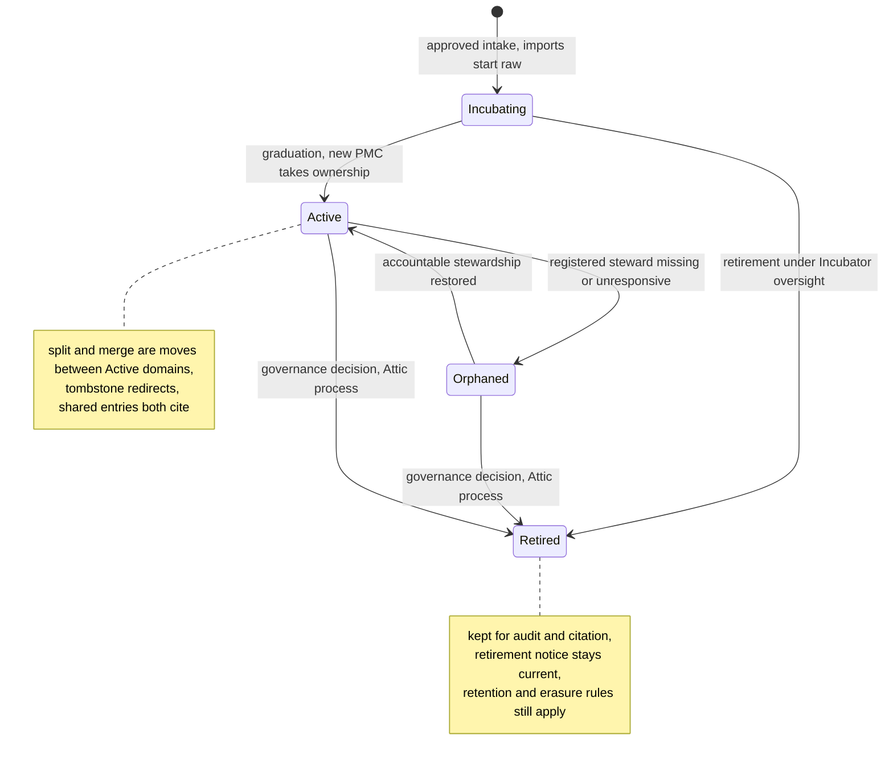

# Seeding a Foundation

### The Apache Software Foundation as a test case for [Durable Memory for Disposable Agents](durable-memory-for-disposable-agents.md)

Sander Striker · August 2026 · revised October 2026

Written with Claude Fable 5, Claude Opus 5 (Anthropic), and GPT-6 Astra (OpenAI).

*The Apache Software Foundation is a hard case for shared agent memory: more than two hundred projects, more than a quarter century of public archives, and a front door anyone can walk through. This case study maps the [companion paper](durable-memory-for-disposable-agents.md) onto it, in enough detail to plan a deployment, and records what the Foundation taught the design.*

This is a proposal. The policies, service tiers, and pilots below are for the responsible ASF bodies to consider; links to ASF sources mark existing practice.

---

## 1. Why this test

The Foundation is a hard case for this design, which makes it a useful one.

| Stress | Why it is hard |
|---|---|
| **Scale and age** | More than two hundred top-level projects and some two dozen podlings in the Incubator, each with its own code, community, and conventions, and archives going back to the 1990s. No one can distil all of it, so [the paper's](durable-memory-for-disposable-agents.md) two speeds (index eligible sources, distil on demand; [paper Appendix B](durable-memory-for-disposable-agents.md#appendix-b-seeding)) are essential |
| **Governance matters as much as code** | The Apache Way (merit, community over code, vendor neutrality, consensus) is what the Foundation exists to protect. A memory that captures code but garbles governance has failed |
| **Public work, private exceptions** | Most work is public: lists, issues, reviews, published board minutes. Personnel matters and undisclosed vulnerabilities are private, and public mail still holds personal information |
| **Open front door** | Anyone can post to a list, open an issue, or send a patch, so anyone can write into the raw tier |
| **Constant churn** | Projects incubate, graduate, split, merge, and retire. Committers come and go over decades, and employers change while hats stay. The registry and the paper's churn rules ([paper §12](durable-memory-for-disposable-agents.md#12-surviving-long-timescales)) are exercised all the time |
| **Federated direction** | PMCs set their projects' technical direction; the board oversees the Foundation and its shared services. The policy stack must hold both ([§5](#5-a-policy-stack-for-a-federation)) |

Each section below tests one part of [the paper](durable-memory-for-disposable-agents.md). [§10](#10-what-the-foundation-taught-the-design) collects what the Foundation taught the design.

---

## 2. Domains and the project lifecycle

**Why.** Memory, policy, and access are organised by domain ([paper §2](durable-memory-for-disposable-agents.md#2-the-design-at-a-glance)), so the domain map decides everything that follows.

The Foundation already partitions work by project. The map starts with **one domain per top-level project or podling**, keyed by a permanent ID. The responsible committee and the project's name are attributes of the domain, so either can change. Foundation-level domains sit alongside: governance, infrastructure, tooling, legal, security, brand, and the Incubator.

Each domain has a steward in [the paper's](durable-memory-for-disposable-agents.md) sense ([paper §5](durable-memory-for-disposable-agents.md#5-the-curator)), the party that answers for it and under whose policy curators work. The registry records who that is:

| Domain | Steward |
|---|---|
| A top-level project | Its PMC (project management committee) |
| A podling | Its podling PMC, under the Incubator PMC's oversight |
| Infrastructure, tooling, legal, security, brand | The responsible officer and team |
| Governance | The board |

ASF governance decides each stage of a project's life; the registry records the decision:



| Lifecycle event | Becomes |
|---|---|
| **Import** | [IP clearance](https://incubator.apache.org/ip-clearance/) decides whether donated code may enter the ASF. Whether its history is accurate is a separate question, so that history arrives raw and earns trust through review ([paper §12](durable-memory-for-disposable-agents.md#identity-when-the-organisation-changes)) |
| **Rename** | Usually during incubation, after the podling name search. The domain ID stays; the new name is a dated assertion ([paper §12](durable-memory-for-disposable-agents.md#12-surviving-long-timescales)) |
| **Graduation** | Record the decision and hand stewardship to the new PMC. Verification can already run during incubation under a policy the Incubator PMC authorises; graduation promotes nothing by itself |
| **Split** | [Solr left Lucene to become its own top-level project in 2021](https://solr.apache.org/whoweare.html): the paper's domain split ([paper §12](durable-memory-for-disposable-agents.md#identity-when-the-organisation-changes)), done by hand. Here curators propose the split with tombstone redirects, and both domains cite the shared history instead of copying it |
| **Merge** | The reverse, done lazily and only on real convergence, as when Lucene and Solr merged development in 2010. Governance and access have to converge as well as the code |
| **Orphaning** | The case the paper calls dangerous ([paper §12](durable-memory-for-disposable-agents.md#identity-when-the-organisation-changes)). Today the board catches it through missed or thin [quarterly reports](https://www.apache.org/dev/pmc.html). Here a missing steward or an overdue response escalates within a published interval, since a name on a roster cannot show that anyone is still watching |
| **Retirement** | The [Attic preserves retired projects' resources](https://attic.apache.org/process-howto.html). In memory, the domain's entries move to the audit-only archive tier, a current retirement notice points at the sources, and a named owner keeps custody. Retired podlings stay under [Incubator oversight](https://attic.apache.org/) |

---

## 3. People and names

**Why.** More than twenty-five years of provenance is only useful if it still points at the right person. At the Foundation, the names around a person change far more often than the person.

The paper's rule is opaque permanent keys plus dated names ([paper §12](durable-memory-for-disposable-agents.md#12-surviving-long-timescales), after RFC 4151). At the Foundation:

- **Committers are keyed by Apache ID**, as `human:apache.org,<date>:<apache-id>`. The dated authority costs nothing and still holds if the Foundation's naming ever changes.
- **Everyone else is keyed by where they were seen.** Most authors in the archives have no Apache ID. A GitHub author is keyed by GitHub's numeric user ID, which survives renames; a Jira or Bugzilla author by that tracker's account; a list poster by the address and the date it was seen. An address is only evidence of who wrote, so linking it to an Apache ID needs corroboration.
- **Other identities are dated assertions.** Commits carry employer email addresses that lapse when people move. GitHub usernames can be renamed, and an old name can pass to someone else. Each is recorded as "this person used this identity from this date to that".
- **Roles are dated too.** Committer and PMC membership are dated from the records that exist: rosters, account creation, board resolutions. "Release manager for 2.4.0" is a fact distilled from the release vote thread. An employer is a dated affiliation kept apart from the identity, which is how "employers change while hats stay" becomes data.
- **Changes add assertions.** A rename, a new employer, or a lapsed role adds one, and old entries keep pointing at the same person. A mistaken link is corrected by a new assertion. Retention and erasure are the only exceptions.

---

## 4. Sources to entries

**Why.** More than twenty-five years of archives can seed far more than any new deployment could write. The question is which sources yield which kind of entry, and which can be cited for decades.

The paper's source table ([Appendix B](durable-memory-for-disposable-agents.md#appendix-b-seeding)) applies row by row. The Foundation's archive discipline supplies what seeding needs most: **stable citations**. Entries cite mailing-list permalinks and message IDs, and keep permitted excerpts under the source's access and retention rules. Links are checked over time, because no host is certain to last twenty years.

The archives stay the original record. The memory holds distilled entries that link back, and its historian ([paper §3](durable-memory-for-disposable-agents.md#3-memory)) records what the fleet did with them.

| Foundation source | Entry type | Notes |
|---|---|---|
| Improvement proposals (KIPs, FLIPs, SPIPs and kin) | Decision candidates | Context, options, and dissent are often already written down. Record whether each was proposed, accepted, rejected, or superseded |
| [VOTE] and [DISCUSS] threads | Decisions | Cite the thread and its recorded result, and keep material dissent. Only a closed vote is a decision |
| Published board minutes, bylaws, Apache Way documents | Inputs to policy L0 and L1 | Responsible people write and approve the policy entries; the imported document is their source |
| Release, security, and licence policy | Policy L2 | The checkable part compiles to gates, including dependency-licence rules |
| Project style guides, commit and review norms | Policy L3 | Owned by the project domain |
| Commit histories | Decision provenance, hazards, files that change together | Revert clusters mark fragile code; the reason comes from the linked threads |
| Reviews | Candidate L3 conventions, evidence of expertise | Recurring comments suggest conventions, cited to their threads; a committer confirms one before it becomes a rule |
| Issues with linked fixes (GitHub, Jira, Bugzilla) | Golden-suite seeds, FAQ entries | Real questions with known resolutions |
| Project sites, docs, wikis | Interface summaries | The breadth-first layer |
| Rosters, release lines, dependency matrices | Facts | Short review clocks; these rot fastest |

Backfill records both when a source was written and when it was imported, so a role recorded in 2004 never becomes a current permission because it was read today.

---

## 5. A policy stack for a federation

**Why.** The paper's policy stack ([paper §7](durable-memory-for-disposable-agents.md#7-the-policy-stack)) assumes one strategy layer. At the Foundation, [PMCs set their projects' technical direction](https://www.apache.org/foundation/how-it-works/) and the [board oversees the whole](https://www.apache.org/board/). Strategy is federated on purpose.

| Layer | At the Foundation |
|---|---|
| **L0** | Already written: the Apache Way, the licence red lines including prohibited dependency categories, vendor neutrality, release by vote. Seeding L0 means transcribing it, and the responsible ASF bodies approve the transcription; a curator's reading never becomes policy by itself |
| **L1** | No central project strategy, by design. A thin Foundation L1 (shared resources, sustainability, community health, legal posture), with each project's L1 written by its community under PMC oversight and compiled into that domain's rubric |
| **L2** | Foundation and project processes for releases, security handling, branding, and licence checks. The checkable part compiles to gates; decisions that need a person stay with a person |
| **L3** | Project conventions, owned by each domain, distilled largely from review archives |

**Finding: the stack must allow many L1s under one L0.** Each domain orders its own queue ([paper §8](durable-memory-for-disposable-agents.md#8-coordination)). Shared priorities can rank requests for common resources, but cannot commit another project's volunteers. A cross-project task needs each affected owner to accept it, a recorded commitment, and an escalation path.

Each pilot also names a horizon scanner ([paper §7](durable-memory-for-disposable-agents.md#keeping-strategy-in-touch-with-the-world)), with time set aside to bring evidence from users and neighbouring projects into the community's discussions. The steward (a PMC, or the responsible officer for Foundation work) records any resulting change to the rubric and when to check it. Foundation-wide resource conflicts go to the responsible officer or the board. These are the exchanges [the paper's](durable-memory-for-disposable-agents.md) [Viable System Model discussion](durable-memory-for-disposable-agents.md#13-related-work) says people must carry out.

---

## 6. Trust and review

**Why.** Anyone can write to the Foundation, and its reviewers are volunteers. Trust has to hold against anyone writing into the raw tier, and review has to fit the time volunteers actually have.

### Foundation practice informs the gates

These are memory-review rules. ASF voting rules still govern the project decisions themselves, and promoting an entry never stands in for a release vote or grants new authority.

| Foundation practice | Paper mechanism |
|---|---|
| PMC oversight | Promotion to verified is reserved for named people authorised by domain policy ([paper §4](durable-memory-for-disposable-agents.md#4-trust-and-handling)). A current roster makes someone eligible; the policy sets scope and required approvals. Podlings need an Incubator-authorised policy |
| Committers review each other's work | Sampled review of routine curation, and review of golden suites |
| Lazy consensus | Announced, reversible, routine curation proceeds after an objection period where project policy allows. It never replaces a required approval |
| Release votes | Encode the [release policy](https://www.apache.org/legal/release-policy.html): at least three binding +1 votes and more binding +1 than −1. Podling releases also need [Incubator PMC approval](https://incubator.apache.org/guides/releasemanagement.html) |
| Procedural votes and code vetoes | Keep the [voting rules](https://www.apache.org/foundation/voting.html) apart. Procedural votes are by majority; a code veto needs a technical justification and must be resolved; a release −1 is not a veto |
| IP clearance and software grants | Keep the clearance evidence; the imported memory still starts raw ([paper §4](durable-memory-for-disposable-agents.md#4-trust-and-handling)) |

The PMC answers for its memory policy. Reviewers can differ by subject, and no agent has a binding vote.

### An open front door

Anyone can write into the raw tier through public channels, and that openness must stay. After screening, raw from a tap reaches only the task it started and the curators and auditors authorised to see it ([paper §4](durable-memory-for-disposable-agents.md#4-trust-and-handling)). Backfill stays in a scoped import area until curated. The public endpoint serves curated or verified entries only, and agents treat raw text as evidence to weigh.

The incident in [paper §1](durable-memory-for-disposable-agents.md#1-why) shows why. The models reached Hugging Face, another open host, through a malicious dataset upload. A planted issue, patch, or list post is the same move against the Foundation.

Screening and review shrink the risk, and lineage ([paper §3](durable-memory-for-disposable-agents.md#3-memory)) contains what gets through: once a source is found bad, every entry it informed and every result sent from a session that read it can be listed and re-checked. Copies already sent outside cannot be recalled.

### Private lists are the restricted label

The paper's labels ([paper §4](durable-memory-for-disposable-agents.md#4-trust-and-handling)) apply directly. Public archives are public; private and security lists are restricted.

- **Who may read.** Whoever the source itself admits. PMC members read their project's private list, and [ASF members may read all private lists](https://www.apache.org/foundation/governance/members.html). A shared `restricted` label never opens one PMC's material to another: every retrieval also checks the caller's domain and source grants.
- **Where it may go.** Being allowed to read a list does not license sending it to an AI service: the [ASF's confidentiality guidance](https://www.apache.org/foundation/how-it-works/) limits sharing private-list material with third-party services. Restricted material goes only to an approved model deployment, through a harness that routes every outbound path (prompts, logs, tools, sampling) through the perimeter.
- **Who guards.** Domain policy names who may approve disclosure. For vulnerabilities, approval follows the [project's coordinated disclosure process](https://www.apache.org/security/committers.html), with the ASF Security Team involved.

A summary for a wider audience goes through `declassify`. The guard approves the exact public text and metadata, while the citation and lineage stay in the restricted record. A private thread's subject, participants, and URL can leak on their own, so they stay out of the public view unless approved too.

Posting is a follow-up task for a fresh session that reads only public material. The session that read the private thread can never post publicly, because its label never falls.

```mermaid
sequenceDiagram
    autonumber
    participant A as Agent, handling restricted
    participant P as Perimeter
    participant M as Memory
    participant G as PMC, guard
    participant X as Worker on the follow-up task
    participant T as List tap, ceiling public

    A->>P: get(entry distilled from private@ thread)
    P->>M: read, current source grant and handling checked
    M-->>P: entry
    P-->>A: entry
    Note over A: current label rises to restricted
    A->>P: post summary to users@ through the list tap
    P-->>A: denied, restricted exceeds ceiling public
    A->>P: declassify(entry, public, "summary for users@")
    P->>G: proposal, held at restricted
    G-->>P: approve exact public text and metadata
    P->>M: public entry; private citation kept in restricted lineage
    Note over A: A's label never falls, so A goes no further
    X->>P: get(public entry)
    P-->>X: entry, label stays public
    X->>P: post summary through the list tap
    P->>T: allowed, public within ceiling public
```

Lineage audits this path too. An authorised auditor can ask "Which public entries descend from material read on private@?", and each answer should carry a recorded declassification with its guard named. Public readers see only the metadata approved for publication.

### People deserve a policy before the pipeline runs

The archives hold more than twenty-five years of individuals arguing, deciding, and occasionally behaving badly, all in public. The paper leaves profiles of people to policy ([Appendix B](durable-memory-for-disposable-agents.md#appendix-b-seeding)). This proposal asks the responsible ASF bodies to set that policy before the first distillation pass:

- entries describe roles, process, and norms;
- roles and public records (committer, PMC member, release manager for a version) are facts;
- behavioural profiles of named people, patterns of persuasion included, are prohibited. Review gates and adversarial tests look for them, and a violation is removed and its lineage reviewed.

The rule binds the Foundation's tooling and domains. A committer's own domain ([§7](#7-a-committer-owns-a-domain)) is theirs, but Foundation tooling may not build a prohibited profile and put it there.

---

## 7. A committer owns a domain

**Why.** Committers outlast their employers and often their projects. What they choose to keep should go where they go.

The Foundation keeps project work and role history in its own domains. A committer's preferences and notes go into a domain the committer controls ([paper §12](durable-memory-for-disposable-agents.md#12-surviving-long-timescales)). Foundation or employer tooling may only propose entries there; the person admits or refuses them, and unanswered proposals expire. Having a domain to put it in is never a reason to collect more about a person.

At the Foundation this reduces to three rules:

- **Work goes to the project**, under the committer's name, with the agent and model recorded.
- **What is about the person is theirs; what is about the work stays.** Preferences and notes go with them. Project decisions stay with the project, however useful they would be in the next job.
- **Private lists still bind.** An entry about the committer written while reading a private list carries that label, and leaves only through the list's guard.

When a committer leaves, their domain goes with them, exported within its source restrictions. The Foundation's access is revoked and its cached views are dropped with receipts; their project contributions stay.

---

## 8. Serving and who pays

**Why.** A foundation can subsidise an index for everyone but cannot fund unbounded inference. Who gets what has to follow from roles the Foundation already records.

Apache accounts and project rosters are the starting point for allocating an explicitly funded service. An account or a contributor licence agreement on its own grants neither restricted access nor an inference budget.

| Principal | `recall` runs | Scope | Why |
|---|---|---|---|
| **Committer or PMC member** | Server-side, on approved models, within an allocated budget and published latency and reliability targets | Subsidised in their project's domains, wider by policy; source grants still apply | They review and maintain the corpus. Subsidised recall pays them back, and their failed searches feed the distillation queue |
| **Contributor on the on-ramp** | A capped allowance, granted by a PMC, expiring | Granted per domain | Mentees, programme participants, release helpers: the people the Foundation wants more of |
| **Public** | On the caller's own model, through the client's sampling or a lookup loop the client runs; `search` and `get` free | Public entries, curated or verified | The archives were always free to read; deeper help costs the caller's own tokens |

- **The index is subsidised; inference is metered.** Storage, indexing, bandwidth, and abuse prevention still cost money, so public lookup has rate and size limits, and model-assisted search counts as inference.
- **Limits sit in the perimeter.** A committer credential caught in a runaway loop hits its cap and raises an alert automatically.
- **Limits cover spend and throughput** ([paper §12](durable-memory-for-disposable-agents.md#12-surviving-long-timescales)). Commercial models are capped in money and in a share of the Foundation's rate limits with each vendor; Foundation-hosted capacity is capped in time share. Both are shared pools: one committer's burst is another's queue.

**Finding: rosters inform review rights and serving tier; policy grants them.** Every operation checks roster, policy, source grants, and expiry. A change invalidates cached filters and views, and a session that loses a grant it depends on stops ([paper §6](durable-memory-for-disposable-agents.md#6-retrieval-and-serving)). Budget changes apply before the next model call.

---

## 9. The seeding plan

**Why.** Seeding is where a wrong or planted fact is cheapest to insert and hardest to find later. The plan keeps it on the ordinary, gated path of [Appendix B](durable-memory-for-disposable-agents.md#appendix-b-seeding).

Start with current domain owners, approved source access, and a review budget. Then follow [the paper's](durable-memory-for-disposable-agents.md) plan: live taps first, then backfill of eligible archives through the same pipeline, oldest first. Source dates and origin IDs are kept, so a replay cannot duplicate tasks or revive an old role as a grant.

Everything is indexed ahead of distillation, within the raw-reach limits of [§6](#6-trust-and-review), and failed searches decide what to distil next. Three choices are specific to the Foundation.

- **One interface summary per pilot domain, first.** What it is, its architecture in a paragraph, governance status, key contracts, where its decisions live. Its reviewers verify it, as [Appendix B](durable-memory-for-disposable-agents.md#appendix-b-seeding) requires, before agents rely on it. More domains follow only after the pilots pass.
- **Golden suites come from users.** Questions asked on user lists and in issues, paired with the resolutions the archives record, become per-project evaluation suites, and committers review them. Questions the community struggled to answer form the stratum of past failures ([paper §11](durable-memory-for-disposable-agents.md#11-evaluating-change)).
- **A dormant project's 2004 threads stay indexed and undistilled** until a real question needs them, under their retention policy.

### Trackers are the ledger's taps

GitHub issues, Jira, and Bugzilla are where work already arrives, and they stay there ([paper §8](durable-memory-for-disposable-agents.md#8-coordination)).

- The registry maps each repository and tracker project to its domain. An issue becomes a `proposed` task citing the issue as its `origin`, and triage decides whether to admit it. Backfill never reopens closed work.
- A label applied by an authorised committer is evidence triage can weigh. It grants no tools or permissions, and counts as a required sign-off only where policy says so.
- Results return as drafts or proposed changes through a governed tool server, under the fleet's identity, and the project's own people decide what merges or closes. The tool server checks the claim generation before sending, so an expired worker cannot act, and an uncertain post is reconciled before the task is reassigned.

### Pilots span the range

Four pilots, deliberately different:

- one large, fast-moving project with a formal proposal culture;
- one mature, stable project with decades of history;
- one podling, to test stewardship in incubation and the handover at graduation; its earlier history arrives through the ordinary import path;
- the Foundation's [Tooling initiative](https://tooling.apache.org/), which the Foundation supports directly instead of through a PMC. Its [core team of paid contractors works with volunteers](https://tooling.apache.org/team.html), and its products, such as Apache Trusted Releases, serve every PMC and podling. It tests a Foundation-level domain under an officer, review by paid staff and volunteers together, and a queue of requests from many projects.

Before expanding, each pilot must show that memory pays on its own tasks, in paired runs with and without memory ([paper §11](durable-memory-for-disposable-agents.md#11-evaluating-change)). Success criteria and margins are fixed before the runs, both arms keep ordinary repository and tracker access, and evaluation questions are held out of curation, so a stored answer cannot pass for useful memory.

The pilot scorecard covers more than model tokens:

| Check | Evidence required before expansion |
|---|---|
| **Useful answers** | Task success and cost per successful task, counting curation, infrastructure, and reviewer time; wrong answers and omitted dissent inspected |
| **Review capacity** | Review hours, queue age, and escalation response stay within limits the steward agreed. Intake drops or promotions pause when review falls behind |
| **Trust and access** | Planted instructions, mistaken identity links, expired grants, roster revocation, and private metadata in public summaries all tested; an unresolved failure blocks expansion |
| **Recovery** | A rebuild from a recovery bundle recovers pending tasks, rejects old claims, reconciles uncertain sends, and keeps later erasures erased |
| **Local direction** | A strategy review changes the rubric in response to users; cross-project commitments have accepting owners and an escalation path |

Pilots start with public material. Restricted sources follow only after their owners approve the processing and the access and disclosure tests pass. Each pilot needs a named operator, a funded operating period, and a way to stop ingestion and serving without losing the record.

---

## 10. What the Foundation taught the design

| Pressure | Finding | Where the design answers |
|---|---|---|
| **Federated strategy** | Many L1s under one L0, with local strategy reviews and accepted cross-project commitments ([§5](#5-a-policy-stack-for-a-federation)) | Per-domain rubrics and local responsibility ([paper §8](durable-memory-for-disposable-agents.md#8-coordination)) |
| **Volunteer time is scarce** | Every review gate spends volunteer time. So: sampled review for the routine, batched digests, PMC-set strictness within shared policy, and curation intake sized to the review time available. The pilots measure whether subsidised recall pays reviewers back | Gates scale with impact (paper [§5](durable-memory-for-disposable-agents.md#5-the-curator), [§8](durable-memory-for-disposable-agents.md#8-coordination)) |
| **Transparency applies to the memory too** | An institution that publishes its board minutes should expect its memory and policy to be public too. Query text, private-source citations, and individual usage are the exceptions, so telemetry gets its own access and retention rules | The read filter applies to every view ([paper §6](durable-memory-for-disposable-agents.md#6-retrieval-and-serving)) |
| **The serving layer may lose funding** | The knowledge survives if someone keeps readable recovery bundles and the erasure journal, and entries still cite permalinks. Generated instruction stubs hold only pointers. An unfunded year loses freshness and review | The record test and the recovery drill ([paper §12](durable-memory-for-disposable-agents.md#12-surviving-long-timescales)) |
| **Tooling is contributed** | Foundation tooling comes from Infra, the Tooling initiative, volunteer teams such as Whimsy, and projects. Each production component gets an operator and an adopted version, and generated skill pointers are checked against approved bundles at load time | The ownership test ([paper §12](durable-memory-for-disposable-agents.md#12-surviving-long-timescales)), [Appendix B](durable-memory-for-disposable-agents.md#appendix-b-seeding) |
| **Names move constantly** | Employers, usernames, and project names change; people and projects persist ([§3](#3-people-and-names)) | Dated identity ([paper §12](durable-memory-for-disposable-agents.md#12-surviving-long-timescales)) |

None of these needed a structural change to the design. Whether the result is affordable and workable is for the pilots to show.

---

## 11. Risks and open questions

These are deployment risks. The pilots are chosen to surface them early.

- **Distilling culture.** Process norms distil from observable behaviour, but telling a norm from a habit takes judgment. Early distillations need heavier PMC review until faithfulness sampling shows they hold.
- **Review capacity at scale.** Even four pilots need reviewers who have agreed to the work, and at three of them the reviewers are volunteers. Measure review time and decision delay before estimating capacity for more, and watch that sampling does not hide a growing backlog.
- **Privacy beyond policy.** Aggregation changes what can be inferred from public archives. Test entries and generated answers for prohibited profiling, offer a route to correction and erasure, and keep sensitive queries out of public telemetry. Gates will miss some violations.
- **Client support for sampling.** [MCP sampling](https://modelcontextprotocol.io/specification/2025-11-25/client/sampling) is a capability the client negotiates, and the client controls model access and approval. Where a client lacks it, public users get `search` and `get` and run the loop themselves. Measure usability and cost across clients.
- **Planted material.** How often planted content reaches a curated tier, and how fast lineage finds what it touched, should be measured from the first pilot.
