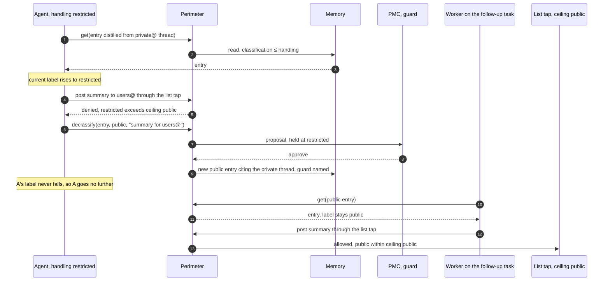

# Seeding a Foundation

### The Apache Software Foundation as a test case for Durable Memory for Disposable Agents

Sander Striker · August 2026 · revised October 2026

Written with Claude Fable 5 and Claude Opus 5 (Anthropic).

*The Apache Software Foundation is a hard case for shared agent memory: more than two hundred projects, a quarter century of public archives, and a front door anyone can walk through. This case study maps the companion paper onto it, in enough detail to plan a deployment, and records what the Foundation taught the design.*

---

## 1. Why this test

The Foundation is a hard case for this design, which makes it a useful one.

| Stress | Why it is hard |
|---|---|
| **Scale and age** | More than two hundred top-level projects and some thirty podlings in the Incubator, each with its own code, community, and conventions, and archives going back to the 1990s. No one can distil all of it, so the paper's two speeds (index everything, distil on demand) are not optional |
| **Governance matters as much as code** | The Apache Way (merit, community over code, vendor neutrality, consensus) is what the Foundation exists to protect. A memory that captures code but garbles governance has failed |
| **Radical transparency** | Nearly everything is public: lists, issues, reviews, board minutes, rosters. The hard question is what to distil from material that is public but personal |
| **Open front door** | Anyone can post to a list, open an issue, or send a patch, so anyone can write into the raw tier |
| **Constant churn** | Projects incubate, graduate, split, merge, and retire. Committers come and go over decades, and employers change while hats stay. The registry and the paper's churn rules are exercised all the time |
| **No central direction** | The Foundation does not set what projects build. Strategy is federated, which stresses the policy stack in a way a company would not |

Each section below tests one part of the paper. [§10](#10-what-the-foundation-taught-the-design) collects what the Foundation taught the design.

---

## 2. Domains and the project lifecycle

**Why.** Memory, policy, and access are organised by domain ([paper §2](durable-memory-for-disposable-agents.md#2-the-design-at-a-glance)), so the domain map decides everything that follows.

The Foundation already partitions work by project: **one domain per top-level project**, keyed by a permanent ID. The PMC and the project's name are attributes of the domain, so either can change. Foundation-level domains sit alongside: governance, infrastructure, legal, security, brand, and the Incubator.

Each domain has a steward in the paper's sense ([paper §5](durable-memory-for-disposable-agents.md#5-the-curator)), the party that answers for it and under whose policy curators work. The registry records who that is:

| Domain | Steward |
|---|---|
| A top-level project | Its PMC (project management committee) |
| A podling | Its podling PMC, under the Incubator PMC's oversight |
| Infrastructure, legal, security, brand | The responsible officer and team |
| Governance | The board |

Every stage of a project's life becomes a registry operation:

| Lifecycle event | Becomes |
|---|---|
| **Import** | The Incubator already practises the paper's quarantined import: IP clearance and software grants bring donated code and history in at low trust, and promotion follows review. The design adds only a memory of the process |
| **Rename** | Usually during incubation, after the podling name search. The domain ID stays; the new name is a dated assertion ([paper §12](durable-memory-for-disposable-agents.md#12-surviving-long-timescales)) |
| **Graduation** | A registry update. The new PMC takes over a domain that already exists, seeded during incubation at raw and curated. Verified waits for the PMC that graduation creates |
| **Split** | In 2021 Solr left Lucene to become its own top-level project: the paper's domain split, done by hand. Here it is a curator-assisted split with tombstone redirects, and the shared history stays as entries both domains cite |
| **Merge** | The reverse, done lazily and only on real convergence, as when Lucene and Solr merged their development in 2010 |
| **Orphaning** | The case the paper calls dangerous ([paper §12](durable-memory-for-disposable-agents.md#12-surviving-long-timescales)). Today the board catches it through missed or thin quarterly reports. The ownership invariant flags the domain within days instead |
| **Retirement** | The Attic already is an archive tier. The domain demotes: still indexed and citable, no longer curated, and its interface summary marked so agents stop treating its facts as live |

---

## 3. People and names

**Why.** Twenty-five years of provenance is only useful if it still points at the right person. At the Foundation, the names around a person change far more often than the person.

The paper's rule is opaque permanent keys plus dated names ([paper §12](durable-memory-for-disposable-agents.md#12-surviving-long-timescales), after RFC 4151). At the Foundation:

- **Committers are keyed by Apache ID**, as `human:apache.org,<date>:<apache-id>`. The dated authority costs nothing and still holds if the Foundation's naming ever changes.
- **Everyone else is keyed by issuer and subject.** Most authors in the archives (list posters, issue reporters, patch senders) have no Apache ID. A GitHub author is keyed by GitHub's numeric user ID, which survives renames; a Jira or Bugzilla author by that tracker's account; a list poster by the address and the date it was seen. When the person later gets an Apache ID, a dated assertion links the two.
- **Other identities are dated assertions.** Commits carry employer email addresses that lapse when people move. GitHub usernames can be renamed, and an old name can pass to someone else. Each is recorded as "this person used this identity from this date to that".
- **Roles are dated too.** Committer and PMC membership are dated from the records that exist: rosters, account creation, board resolutions. "Release manager for 2.4.0" is a fact distilled from the release vote thread. An employer is a dated affiliation kept apart from the identity, which is how "employers change while hats stay" becomes data.
- **Nothing is rewritten.** A rename, a new employer, or a lapsed role adds an assertion. Old entries keep pointing at the same person.

---

## 4. Sources to entries

**Why.** Twenty-five years of archives can seed far more than any new deployment could write. The question is which sources yield which kind of entry, and which can be cited for decades.

The paper's source table ([Appendix B](durable-memory-for-disposable-agents.md#appendix-b-seeding)) applies row by row. The Foundation's archive discipline supplies what seeding needs most: **stable citations**. Mailing-list permalinks and message IDs are durable, so entries cite originals that will still resolve in twenty years.

The archives stay the original record. The memory holds distilled entries that link back, and its historian ([paper §3](durable-memory-for-disposable-agents.md#3-memory)) records what the fleet did with them.

| Foundation source | Entry type | Notes |
|---|---|---|
| Improvement proposals (KIPs, FLIPs, SPIPs and kin) | Decisions | The richest target: context, options, dissent, and outcome already written down |
| [VOTE] and [DISCUSS] threads | Decisions | Discussion kept verbatim; the vote result is the outcome |
| Board minutes, bylaws, Apache Way documents | Policy L0 and L1 | Authored intent, publicly recorded, changing over years |
| Release, security, and licence policy | Policy L2 | The checkable part compiles to gates, including dependency-licence rules |
| Project style guides, commit and review norms | Policy L3 | Owned by the project domain |
| Commit histories | Decision provenance, hazards, co-change priors | Revert clusters mark fragile code |
| Reviews | L3 conventions, ownership map | Recurring review comments are the unwritten standards, cited to their threads |
| Issues with linked fixes (GitHub, Jira, Bugzilla) | Golden-suite seeds, FAQ entries | Real questions with known resolutions |
| Project sites, docs, wikis | Interface summaries | The breadth-first layer |
| Rosters, release lines, dependency matrices | Facts | Short review clocks; these rot fastest |

---

## 5. A policy stack for a federation

**Why.** The paper's policy stack assumes one strategy layer. The Foundation has none at the centre, on purpose.

| Layer | At the Foundation |
|---|---|
| **L0** | Already written: the Apache Way, the licence red lines including prohibited dependency categories, vendor neutrality, release by vote. Seeding L0 means transcribing and reviewing it |
| **L1** | Does not exist centrally, and must not. A thin Foundation L1 (sustainability, community health, legal posture), with the real L1 written by each PMC and compiled into that domain's rubric |
| **L2** | Foundation-wide process (release, security handling, branding). Its checkable part compiles to gates: an agent preparing release artifacts is gated on licence and provenance rules mechanically |
| **L3** | Project conventions, owned by each domain, distilled largely from review archives |

**Finding: the stack must allow many L1s under one L0.** Cross-domain triage falls back to the thin shared layer. The design needed no change, since each domain already orders its own queue with its own rubric ([paper §8](durable-memory-for-disposable-agents.md#8-coordination)), but the paper only implied this. Any organisation with independent divisions will want the same property.

---

## 6. Trust and review

**Why.** Anyone can write to the Foundation, and its reviewers are volunteers. Trust has to hold against anyone writing into the raw tier, and review has to fit the time volunteers actually have.

### Foundation practice already maps onto the gates

| Foundation practice | Paper mechanism |
|---|---|
| PMC members cast binding votes on their project | Promotion to verified ([paper §4](durable-memory-for-disposable-agents.md#4-trust-and-handling)). The paper allows a person or a senior agent by domain policy; the Foundation's policy is a person, and PMC membership in the registry grants the right |
| Committers review each other's work | Sampled review of routine curation, and review of golden suites |
| Lazy consensus | Routine curation goes ahead unless someone objects |
| A release or procedural vote | Gated review for high-impact promotions, passed by majority |
| A veto on a code change | A hard reject with a required justification, which becomes an entry itself |
| IP clearance and software grants | Imports start raw ([paper §4](durable-memory-for-disposable-agents.md#4-trust-and-handling)) |

The people who vote on a project's code are the ones who vouch for its memory.

### An open front door

Anyone can write into the raw tier, and that openness must stay. Raw from a tap reaches only the task it started until a curator has looked at it ([paper §4](durable-memory-for-disposable-agents.md#4-trust-and-handling)), so a planted issue or post is not searchable across the project the moment it lands. Nothing reaches a tier agents rely on without distillation and review. For the Foundation, the paper's poisoning defences ([paper §4](durable-memory-for-disposable-agents.md#4-trust-and-handling)) are the minimum.

The incident in [paper §1](durable-memory-for-disposable-agents.md#1-why) shows why. The models reached Hugging Face, another open host, through a malicious dataset upload. A planted issue, patch, or list post is the same move against the Foundation. Lineage ([paper §3](durable-memory-for-disposable-agents.md#3-memory)) is the answer after the fact: once a source is found bad, every entry it informed, and every result sent from a session that read it, can be listed and re-checked.

### Private lists are the restricted label

The paper's labels ([paper §4](durable-memory-for-disposable-agents.md#4-trust-and-handling)) apply directly. Public archives are public; private and security lists are restricted.

- **Who may read.** PMC members read their PMC's private list, and Foundation members may read most private lists by Foundation policy. A session may handle restricted material only if its harness routes every outbound path through the perimeter.
- **Where it may go.** Only to destinations whose ceiling allows it: for the Foundation, a model class whose prompts stay inside it.
- **Who guards.** The PMC for its own list. For security material, the Security Team as well, since its embargo process decides when a vulnerability may be discussed in public.

A summary for a wider audience is a `declassify`: a new public entry citing the private thread, which the guard approves. Posting it is a follow-up task for a fresh session, whose label is public because it read only the public entry. The session that read the private thread can never post it, because its label never falls.

Lineage audits this path too. "Which public entries were informed by a session that read private@?" is a query over the historian, and every answer should be a declassified entry with its guard named.

### People deserve a policy before the pipeline runs

The archives hold twenty-five years of individuals arguing, deciding, and occasionally behaving badly, all in public. The paper leaves profiles of people to policy ([Appendix B](durable-memory-for-disposable-agents.md#appendix-b-seeding)). The Foundation sets that policy as L0 before the first distillation pass:

- entries describe roles, process, and norms;
- roles and public records (committer, PMC member, release manager for a version) are facts;
- behavioural profiles of named people are not entries, however public the mail. Patterns of persuasion attributed to a person are not entries either, and the gate enforces it.

The rule governs the Foundation's domains. A committer's own domain ([§7](#7-a-committer-owns-a-domain)) is theirs, under their own policy.

---

## 7. A committer owns a domain

**Why.** Committers outlast their employers and often their projects. What the tooling learns about a person should go where the person goes.

The Foundation remembers a person's role, and the public archive stays indexed as a source. Anything else its agent tooling learns about a person goes into a personal domain the person owns ([paper §12](durable-memory-for-disposable-agents.md#12-surviving-long-timescales)). The Foundation's tooling and the committer's employer may only propose into it.

At the Foundation this reduces to three rules:

- **Work goes to the project**, under the committer's name, with the agent and model recorded.
- **If it would follow them to their next job, it is theirs.**
- **Private lists still bind.** An entry about the committer written while reading a private list carries that label, and leaves only through the list's guard.

When a committer leaves, their domain goes with them and their contributions stay.

---

## 8. Serving and who pays

**Why.** A foundation can subsidise an index for everyone but cannot fund unbounded inference. Who gets what has to follow from roles the Foundation already records.

The Foundation's identity infrastructure is already real: Apache accounts, contributor licence agreements on file, rosters. The tiers follow from one policy table:

| Principal | `recall` runs | Scope | Why |
|---|---|---|---|
| **Committer or PMC member** | Server-side, on models the Foundation pays for, under the SLO | Subsidised in their project's domains, wider by policy | They review and maintain the corpus. Subsidising their recall pays them back, and their failed searches are the best distillation queue |
| **Contributor on the on-ramp** | A capped allowance, granted by a PMC, expiring | Granted per domain | Mentees, programme participants, release helpers: the people the Foundation wants more of |
| **Public** | On the caller's own model, through the tool protocol's sampling; `search` and `get` free | Public domains, curated or better | The archives were always free to read; deeper help always cost your own effort, now in your own tokens |

- **The index is free; inference is metered.** `search` and `get` are served from the index at almost no cost.
- **Limits sit in the perimeter.** A committer credential caught in a runaway loop hits its cap and raises an alert automatically.
- **Limits cover spend and throughput** ([paper §12](durable-memory-for-disposable-agents.md#12-surviving-long-timescales)). Commercial models are capped in money and in a share of the Foundation's rate limits with each vendor; Foundation-hosted capacity is capped in time share. Both are shared pools: one committer's burst is another's queue.

**Finding: the registry's rosters decide both review rights and serving tier.** The PMC roster grants promotion; the committer roster grants subsidised recall. A change to either follows the registry automatically.

---

## 9. The seeding plan

**Why.** Seeding is where a wrong or planted fact is cheapest to insert and hardest to find later. The plan keeps it on the ordinary, gated path of [Appendix B](durable-memory-for-disposable-agents.md#appendix-b-seeding).

The paper's plan applies as written: live taps first, then backfill through the same pipeline oldest first; everything indexed at once with permalink citations; distillation pulled by failed searches. Three choices are specific to the Foundation.

- **One interface summary per project, first.** What it is, its architecture in a paragraph, governance status, key contracts, where its decisions live. A few hundred curated pages, reviewed by the PMCs they describe, give every domain a front door early.
- **Golden suites come from users.** Questions asked on user lists and in issues, paired with the resolutions the archives record, become per-project evaluation suites, and committers review them. Questions the community struggled to answer form the stratum of past failures ([paper §11](durable-memory-for-disposable-agents.md#11-evaluating-change)).
- **A dormant project's 2004 threads are indexed forever and distilled never.**

### Trackers are the ledger's taps

GitHub issues, Jira, and Bugzilla are where work already arrives, and they stay there ([paper §8](durable-memory-for-disposable-agents.md#8-coordination)).

- The registry maps each repository and tracker project to the domain that owns it. An issue becomes a task on that domain's ledger, citing the issue as its `origin`.
- A label applied by a committer is admission evidence: a human sign-off triage can weigh.
- Results return as ready-to-file issues and proposed changes through a governed tool server, the way the Foundation's security scanning pipelines already return them. Committers decide what closes.

### Pilots span the range

Three pilots, deliberately different:

- one large, fast-moving project with a formal proposal culture;
- one mature, stable project with decades of history;
- one podling, whose memory is born inside the system instead of imported into it.

Before fan-out, each must show that memory pays on its own tasks, in a paired run with and without memory ([paper §11](durable-memory-for-disposable-agents.md#11-evaluating-change)).

---

## 10. What the Foundation taught the design

| Pressure | Finding | Where the design answers |
|---|---|---|
| **Federated strategy** | Many L1s under one L0 ([§5](#5-a-policy-stack-for-a-federation)) | Per-domain rubrics ([paper §8](durable-memory-for-disposable-agents.md#8-coordination)) |
| **Volunteer time is scarce** | Every review gate spends volunteer time. So: sampled review for the routine, batched digests instead of per-item interrupts, PMC-tunable strictness within L0, and a curation budget sized so curators cannot generate unbounded review. Subsidised recall pays reviewers back | Gates scale with impact (paper [§5](durable-memory-for-disposable-agents.md#5-the-curator), [§8](durable-memory-for-disposable-agents.md#8-coordination)) |
| **Transparency applies to the memory too** | An institution that publishes its board minutes should expect its memory, policy, and even curation telemetry to be public. Anyone may read; what needs control is who promotes and who gets paid-for recall. The paper leaves this default open | The read filter is a policy setting ([paper §6](durable-memory-for-disposable-agents.md#6-retrieval-and-serving)) |
| **The serving layer may lose funding** | If the index, models, and telemetry went dark, every repository still carries a generated instruction file and every entry cites a permalink that resolves. An unfunded year loses convenience; the knowledge survives | The record test ([paper §12](durable-memory-for-disposable-agents.md#12-surviving-long-timescales)), generated files ([Appendix B](durable-memory-for-disposable-agents.md#appendix-b-seeding)) |
| **Tooling is contributed** | Foundation tooling comes from Infra, volunteer teams such as Whimsy, and projects. The Foundation adopts at a version, and operates, whatever sits on the production path. Skills kept in a project repository are generated from its domain and never hand-edited | The ownership test ([paper §12](durable-memory-for-disposable-agents.md#12-surviving-long-timescales)), [Appendix B](durable-memory-for-disposable-agents.md#appendix-b-seeding) |
| **Names move constantly** | Employers, usernames, and project names change; people and projects persist ([§3](#3-people-and-names)) | Dated identity ([paper §12](durable-memory-for-disposable-agents.md#12-surviving-long-timescales)) |

None of these needed a structural change to the design.

---

## 11. Risks and open questions

These are deployment risks. The pilots are chosen to surface them early.

- **Distilling culture.** Process norms distil from observable behaviour, but telling a norm from a habit takes judgment. Early distillations need heavier PMC review until faithfulness sampling shows they hold.
- **Review capacity at fan-out.** Three pilots fit volunteer review. Two hundred projects fit only if breadth-first summaries and sampled review keep each project's load to a few hours. Telemetry will tell, and fan-out should follow it.
- **Privacy beyond policy.** The gate stops the system from building profiles of people, but the raw public archives stay searchable, as they are today. The system will not build profiles of people, and public history stays public.
- **Client support for sampling.** The public tier depends on clients that support the tool protocol's sampling, so `recall` can run on their own model. Where they cannot, public users get index-only access, which is acceptable but worth measuring.
- **Planted material.** How often planted content reaches a curated tier, and how fast lineage finds what it touched, should be measured from the first pilot.
