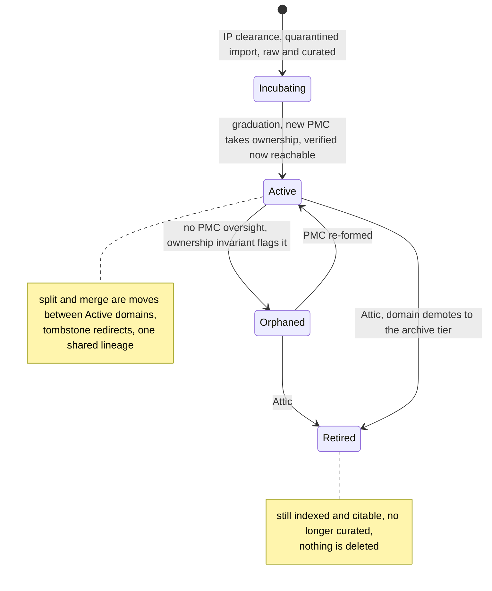
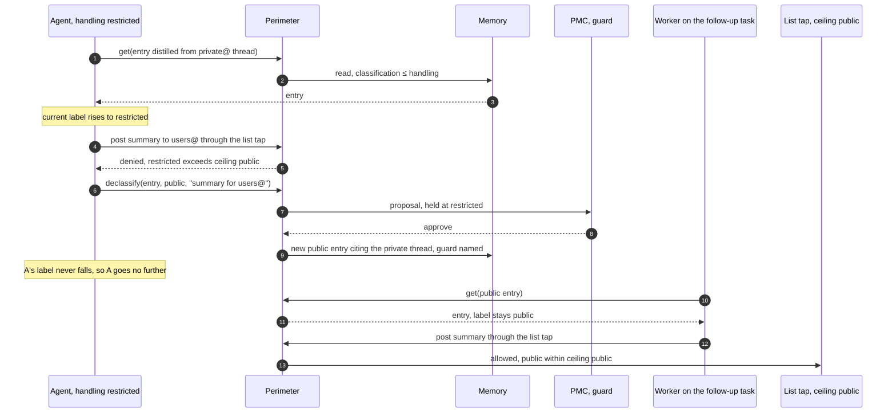
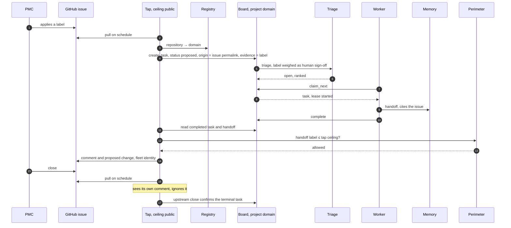

# Seeding a Foundation

### The Apache Software Foundation as a test case for Durable Memory for Disposable Agents

Sander Striker · August 2026 · revised September 2026

*The companion white paper describes an architecture in the abstract. This case study instantiates it against a real institution: the Apache Software Foundation, with its three-hundred-odd projects, a quarter century of public archives, and a governance culture that is itself the product. The exercise runs in both directions. The architecture is mapped onto ASF concretely enough to plan a deployment, and ASF is used to stress the architecture where an abstract paper cannot: federated strategy, volunteer bandwidth, radical transparency, and knowledge that outlives every one of its authors.*

---

## 1. Why this test

ASF is close to a worst case in every dimension the architecture claims to handle, which is what makes it an honest test.

**Scale and age.** Over three hundred top-level projects, each with its own codebase, community, and conventions, and mailing-list archives reaching back to the 1990s. No seeding effort can distill all of it; the two-speed doctrine is not optional here.

**Governance as product.** The Apache Way, merit through contribution, community over code, vendor neutrality, consensus with veto rights, is not documentation around the software; it is the thing the foundation exists to protect. A memory system that captures code knowledge but garbles governance culture has failed the test.

**Radical transparency.** Nearly everything is already public: lists, issues, reviews, board minutes, rosters. This removes the usual seeding obstacle (access) and replaces it with a sharper one (what should be distilled from material that is public but personal).

**Perpetual churn.** Projects enter through an incubator, graduate, split, merge, and retire to an Attic. Committers arrive and leave over decades. Employers change while hats stay. The registry indirection and org-churn machinery of the paper get exercised constantly, not occasionally.

**No central authority over direction.** The foundation does not direct what projects build; that is a founding choice. Strategy is federated by design, which stresses the policy stack in a way a conventional organization would not.

---

## 2. The domain map

The capability partition is unusually clean because ASF already partitions by capability: **one domain per top-level project**, keyed by project, not by PMC. Foundation-level domains sit alongside: governance, infrastructure, legal and licensing, security, brand, incubator.

The registry maps PMCs to the domains they own, and the foundation's project lifecycle maps onto the paper's churn machinery (§12) and archive tier (§4):

- **Graduation.** A podling graduating from the incubator is a registry update: the new PMC takes ownership of a domain that already exists, seeded during incubation at raw and curated, with promotion to verified waiting on the PMC that graduation creates.
- **Split.** When Lucene and Solr separated into distinct top-level projects in 2021, that was the paper's domain-split case executed by hand: shared history, diverging ownership, references that must not dangle. Under this architecture it is a librarian-assisted split with tombstone redirects, and the shared pre-split history remains one lineage both domains cite. A merge is the same move in reverse, lazy, on real convergence.
- **Orphaning.** A project whose PMC can no longer muster oversight is the paper's orphaned domain, the case §12 calls the dangerous one. The board's roll call and the Attic process are the existing check; the memory's ownership invariant flags the domain within days instead of at the next report. The domain returns to active if a PMC is re-formed, or retires to the Attic.
- **Retirement.** The Attic is the archive tier made institutional. A retired project's domain demotes: still indexed, still citable, no longer curated, and its interface summary marked accordingly so agents stop treating its facts as live.
- **Import.** Incubator IP clearance and the software grant process are the quarantined import tier already practiced as law: donated code and its history enter at low trust and earn promotion through review. The architecture adds nothing here except memory of the process itself.

The lifecycle as the registry sees it, each transition the operation it becomes:

---

## 3. Sources to entries

Appendix B's source table instantiates row by row, and ASF's archive discipline supplies the one property seeding needs most: **stable citations**. Mailing-list permalinks and message identifiers are durable anchors, so distilled entries cite originals that will still resolve in twenty years. The upstream archives remain the canonical raw store; the memory holds distilled entries that point back.

| ASF source | Entry type | Notes |
|---|---|---|
| Improvement proposals (KIPs, FLIPs, SPIPs and kin) | Decisions | The richest target: context, options, dissent, and outcome already written down per proposal |
| [VOTE] and [DISCUSS] threads | Decisions | Consensus mechanics preserved verbatim; the vote result is the label |
| Board minutes, bylaws, Apache Way documents | Policy L0 and L1 | Authored intent, publicly recorded, changing over years |
| Release policy, security process, license policy | Policy L2 | The machine-checkable subset compiles to gates, including dependency-license rules |
| Per-project style guides, commit conventions, review norms | Policy L3 | Owner is the project domain |
| Commit histories | Decision provenance, hazard entries, co-change priors | Revert clusters mark fragile zones; co-change seeds prefetch before telemetry exists |
| Reviews | L3 conventions, ownership map | Recurring review comments are the unwritten standards, cited to their threads |
| Issue trackers with linked fixes | Golden-suite seeds, FAQ entries | Real user questions with ground-truth resolutions |
| Project sites, docs, wikis | Interface summaries | The breadth-first layer |
| Rosters, release lines, dependency matrices | Facts | Short review clocks; these rot fastest |

---

## 4. A policy stack for a federation

Mapping the stack surfaces the case study's first genuine finding.

**L0 is easy and already written.** The Apache Way, the license red lines (including the prohibited dependency categories), vendor neutrality, release-by-vote: these are the non-overridable core, authored over decades, publicly amended through documented process. Seeding L0 is transcription plus review, not invention.

**L2 and L3 map directly.** Foundation-wide process rules (release policy, security handling, branding) are L2, and their checkable subset compiles to gates: an agent preparing release artifacts is gated on license and provenance rules deterministically, not by good intentions. Project conventions are L3, owned by each domain and distilled largely from review archives.

**L1 does not exist centrally, and must not.** The foundation has no central product strategy by design; each project sets its own direction. The stack therefore holds a thin foundation L1 (sustainability, community health, legal posture) while real L1 lives per domain, authored by each PMC, compiling into per-domain scoring rubrics. The architecture supports this without modification, since rubrics were always compiled per domain, but the case makes explicit what the abstract paper only implies: **the policy stack must tolerate a federation of L1s under one L0**, with cross-domain triage falling back to the thin shared layer. Any multi-division organization will eventually want the same property.

---

## 5. Trust, review, and twenty-five years of people

**Committers are the promotion gate, and the mapping is exact.** The architecture wants a reviewer for promotion into verified, human or senior agent by domain policy; ASF's policy is a human, and it already defines precisely who may bless truth about a project. PMC membership in the registry grants promotion-review rights for that domain, which means review authority derives from the same source that governs the code. Lazy consensus maps to sampled review for routine curation; explicit votes map to gated review for high-impact promotions; the veto maps to a hard reject with required justification, which becomes a memory entry itself.

**Public writability is the standing threat model.** Anyone can post to a list, open an issue, or send a patch, which means anyone can write into the raw tier. That openness is constitutive and must remain; the trust tiers exist exactly for this. Raw is indexed and searchable with provenance attached; nothing reaches agent-trusted tiers without distillation and committer-gated review. The memory-poisoning defenses of the paper are not extra caution here; they are the minimum viable posture for an institution whose front door is open.

**Private lists are the restricted label.** The paper's classification (paper §5) instantiates directly: public archives are public, private and security lists are restricted, and the PMC owns the label for its lists. A session handles a PMC's restricted material only when its harness routes every outbound path through the perimeter, and it can then send that material only to destinations whose ceiling allows it, which for the foundation means a model class whose prompts stay inside it; the foundation's archive tooling already refuses private and security lists unless explicitly granted. A sanctioned summary of private-list content for a wider audience is the paper's `declassify` with the PMC as guard: a new public entry citing the private thread, approved by the people who own the list, never a side effect of an agent writing what it read. Posting the summary is then a follow-up task for a fresh session, whose label is public because it read only the public entry; the session that read the private thread can never post it, since its label never falls.

**People deserve a policy before the pipeline runs.** The archives contain twenty-five years of individuals arguing, deciding, and occasionally behaving badly, all public. The norms-not-dispositions rule from Appendix B is adopted as written L0 policy before the first distillation pass: community entries describe roles, process, and norms; they do not compile behavioral profiles of named individuals, and the gate enforces it. Roles and public records (committer since, PMC member, release manager for) are facts. Patterns of persuasion attributed to a person are not entries, however public the mail.

---

## 6. Serving, identity, and who pays

Identity does double duty, and ASF's identity infrastructure is already real: foundation accounts, contributor license agreements on file, rosters in the registry. The tier model falls out of one policy table:

| Principal | Recall execution | Scope | Rationale |
|---|---|---|---|
| Committer / PMC member | Server-side, SLO applies | Subsidized in domains their PMC covers, wider by policy | They are the promotion reviewers; subsidizing their recall pays the people who maintain the corpus, and their zero-result queries are the highest-grade distillation queue |
| Contributor on the on-ramp | Capped server-side allowance, PMC-grantable, expiring | Granted per domain | Mentees, program participants, release-adjacent contributors: exactly the population the foundation wants to widen |
| Public | Caller-executed via sampling; index operations free | Public domains at curated trust or better | Symmetry with tradition: the archives were always free to read, and deeper help always cost your own effort, now denominated in your own tokens |

Index operations (`search`, `get`) are free at every tier because they are index-served and nearly free to provide; the foundation subsidizes an index, not inference. Spend limits per principal sit in the deterministic perimeter, so a committer credential wired into a runaway loop is capped and alerted, not debated. Limits are per resource class (paper §12): metered credits for commercial models are capped in money, foundation-hosted capacity in time-share, because one committer's burst on a shared accelerator pool is another's queue.

One property worth stating because it generalizes: **the same registry entry that says who may approve promotions in a domain also prices their recall.** Review authority and serving tier derive from one source of truth, and reorganizations of either follow the registry automatically.

---

## 7. The seeding plan

Per Appendix B, in ASF terms:

**Taps first.** Live feeds from lists, commits, issues, and reviews flow through the ordinary write path into per-domain raw tiers. Backfill then replays history through the same pipeline, oldest first, so the seeding pipeline is exercised, versioned, and improved as a dom-platform artifact before the bulk of history arrives.

**Trackers are the board's taps.** GitHub issues per repository and Jira per project are where work already arrives, and they stay where they are. The registry maps each repository and tracker project to the TLP domain that owns it, so an issue becomes a task on that domain's board with an `origin` citing the issue (paper §7). PMC triage on the tracker is admission evidence: a label the PMC applies is a human sign-off the gate can weight. Results return the way the security pipelines already return them, as ready-to-file issues and proposed changes written through a governed tool server, with the PMC deciding what closes.

**Index everything, immediately.** The full archive corpus becomes searchable with permalink citations in the first phase. Known-item retrieval (an error string, a proposal number, a release name) works foundation-wide before any distillation exists.

**Breadth before depth.** One verified interface summary per project: what it is, architecture in a paragraph, governance status, key contracts, where its decisions live. A few hundred curated pages, reviewed by the PMCs they describe, gives every domain a front door early.

**Depth is pulled.** Zero-result queries and re-query clusters from real usage drive the distillation queue. A dormant project's 2004 threads are indexed forever and distilled never, and that is the correct outcome.

**Pilots span the honest spectrum.** One large, fast-moving project with a formal proposal culture; one mature, stable project with decades of history; one incubating podling whose memory is born inside the system instead of imported into it. Each pilot is held to the M1 and M2 exit criteria of the paper before fan-out: context recovery from handoff and index alone, known-item lookups in the top three, a deliberately degraded summary caught by the suite, and cost per task measured against baseline.

**Golden suites come from users.** The questions people asked on user lists and in issues, paired with the resolutions the archives record, become per-project evaluation suites, reviewed by committers. Evaluation coverage matches demonstrated demand, and the failure-recovery stratum (questions the community historically struggled to answer) tests whether the system can do better than its sources.

---

## 8. What ASF stresses that the paper had to answer

Five pressures, each a finding.

**Federated strategy.** Covered in §4 above: one L0, many L1s, per-domain rubrics, thin shared fallback. The architecture holds, and the requirement is now explicit.

**Volunteer bandwidth is the scarce resource.** The paper's human review gates assume reviewers exist on payroll. Here every human gate spends volunteer time, so the gates must be shaped to respect it: sampled review for the routine, batched digests over per-item interrupts, PMC-tunable gate strictness within L0 bounds, and the protected curation floor keeping librarian work from generating unbounded review demand. The subsidized tier is part of the same answer: the system pays reviewers back in capability.

**Transparency applies to the memory itself.** An institution that publishes its board minutes should expect its distilled memory, its policy stack, and even its curation telemetry to be publicly readable, with the permission system governing writes and expensive operations more than reads. The architecture supports a mostly-public corpus without strain, since the OPA filter is policy, but the case sets a default the abstract paper leaves open: for a foundation, memory defaults to public, and the interesting access-control questions are about recall cost and promotion rights, not secrecy.

**Sustainability of the serving layer.** The record is text and outlives everything, but the index, the deputy models, and the telemetry plane are running costs. The tier model bounds them (subsidize the index, meter the inference), and the derived stubs of Appendix B ensure that if the serving layer ever went dark, every repository still carries a generated digest and every entry still cites a permalink that resolves. The failure mode of an unfunded year is degraded convenience, not lost knowledge, which is the property a decades-old institution should demand.

**Contributed components.** Much of the foundation's tooling is built by projects rather than staff, and the paper's ownership test (paper §12) states the rule the foundation already applies: a contributed server, skill set, or pipeline is adopted at a version and operated by the foundation, or it is not on the path a production agent depends on. Projects that keep agent skills in their own repositories are the in-repo case of Appendix B: those files become digest-keyed stubs derived from the project's domain, served from memory to online consumers and regenerated in the repository for everyone else, so the repository never becomes a second, unowned source of truth.

---

## 9. Risks and open questions

**Distillation quality on culture.** Process norms distill from observable behavior, but the difference between a norm and a habit is judgment; early distillations need heavier PMC review until the faithfulness suites earn trust.

**Review capacity at fan-out.** Three pilots fit volunteer review; three hundred projects only fit if breadth-first summaries plus sampled review keep per-project load to hours, not weeks. The telemetry will say whether that holds, and fan-out pace should follow it.

**Contributor privacy beyond policy.** Norms-not-dispositions is enforced at the gate, but public raw archives remain searchable by design, as they are today. The line the system holds is that it will not manufacture profiles; it cannot and should not make public history less public.

**Sampling-tier client support.** The public tier's economics depend on caller-executed recall being widely supported by clients. Where it is not, the public experience degrades to index-only, which is acceptable but worth measuring.

None of these are architecture risks; they are deployment truths that the milestones are designed to surface early. That is the closing argument for the test case: the architecture required no structural change to fit an institution built on federation, volunteers, and total transparency. The findings it produced (federated L1, gates shaped for volunteer time, public-by-default memory, survivable defunding, institution-operated contributions) are not ASF quirks. They are properties any organization that intends to last should ask of this system, and the foundation simply asks for them first.
